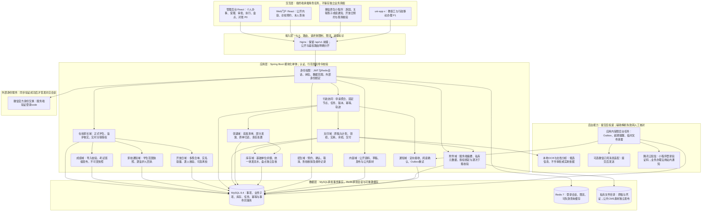
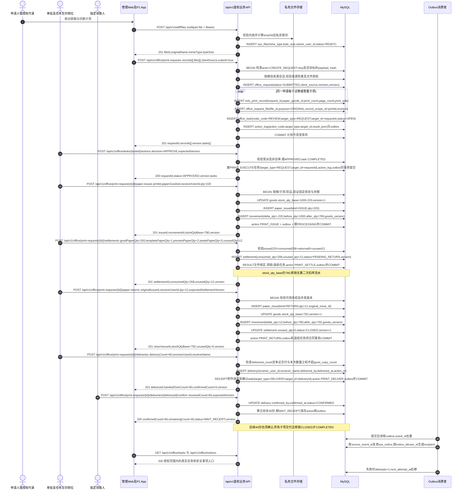

# 校园行政办公平台系统技术设计方案

更新日期：2026-11-06。依据：[产品规划](../product/01-产品规划.md)、[全端功能矩阵](../product/ends/00-全端功能与协同矩阵.md)、现有源码与2026-11-06服务器只读结构复核。本文定义目标方案，明确标注复用、调整和新增；不代表已实施迁移、已修改依赖或已上线。App完整需求已补齐，功能交付仍为P1，P0内部闭环由管理后台授权的个人办事与岗位入口完成。

## 1. 整体系统架构图

### 1.1 分层架构与职责



MySQL是库存、事项状态、待办和幂等结果的最终依据。Redis丢失不能造成重复扣库或丢失申请；通知投递失败不能撤销已提交的收发事实。P0沿用模块化单体，以本地事务覆盖跨业务模块操作，不增加微服务、分布式事务或独立消息集群。

### 1.2 各端现有技术栈与目标调整

| 范围 | 已核查现状 | 目标技术基线与调整 |
| --- | --- | --- |
| 后端 | Java17、Spring Boot4.0.3、Spring MVC/Security、MyBatis-Plus 3.5.17（Boot 4 starter）、Druid Boot4 starter、Quartz | 统一使用 MyBatis-Plus 会话工厂。既有 Mapper XML 及 PageHelper 6.1.1 分页兼容保留，新简单 CRUD 使用 BaseMapper，复杂查询与事务内锁定使用 Mapper XML。 |
| 后端分页 | PageHelper starter2.1.1与Boot4组合 | 调整到官方支持Boot4及Java17的发布线，以4.1.0作为兼容验证基线；验证分页总数、排序和数据范围后更新锁定版本。 |
| HTTP序列化 | Boot4默认Jackson3，项目仍有Jackson2自定义脱敏与Fastjson2使用 | HTTP统一Jackson3并迁移自定义脱敏、日期与响应配置；Redis现有序列化单独兼容迁移，避免同时破坏会话。 |
| 管理后台 | React19、TypeScript6、Vite8、AntD6、ProComponents2.8.10、ProLayout7.22.7、Router6、Zustand5 | 保留React、TS、Vite和AntD6。Pro2与AntD6的peer契约冲突必须消除：迁移到声明支持AntD6的Pro3单一聚合包并移除旧独立子包导入，核对锁文件；发布版本以隔离验证通过的具体版本为准。 |
| Web门户 | React19、TypeScript6、Vite8、AntD6、Tailwind4、Router7、Zustand5 | 保留。两个独立Web工程的Router大版本不同并不构成跨端业务错误，不为统一版本重写既有路由。共享接口契约、身份及业务规则。 |
| 微信小程序 | 原生WXML/WXSS/JS、TDesign、HTTP dispatcher，部分素材使用微信云存储 | 保留原生工程。校正指向不存在目录的npm构建配置；业务访问逐步统一到同一后端，员工身份绑定与游客分开；附件归属向统一文件服务迁移。 |
| App | uni-app x、UTS、uvue、uView Ultra、reactive store；残留Vue2/Vuex和同名JS/UTS文件 | 保留uni-app x，P1锁定HBuilderX版本、目标平台和编译模式，收敛UTS入口及现有reactive状态。清理已确认无引用的旧入口前验证打包，不新增第二套状态管理。 |
| 数据 | 实测MySQL8.4.11、Redis二进制7.0.15；数据库隔离级别REPEATABLE-READ | 保留MySQL8.4与Redis7。使用InnoDB行锁、版本条件、唯一约束和事务流水保证正确性，Redis不承载库存锁的最终正确性。 |
| 部署 | Ubuntu24.04体系、Nginx1.24、Java17、Node22.23.3；main触发SSH后在服务器构建，原生服务运行 | 保留Linux原生部署；锁定Node22受支持版本和npm版本。依赖契约修正后使用可复现安装，前后端产物保留可回滚版本；历史Docker模板不混用。 |

依据：Boot4对Java与Jackson的规则见[官方迁移指南](https://github.com/spring-projects/spring-boot/wiki/Spring-Boot-4.0-Migration-Guide)及[JSON说明](https://docs.spring.io/spring-boot/4.0/reference/features/json.html)；PageHelper候选的JDK与依赖组合见[4.1.0官方POM](https://raw.githubusercontent.com/pagehelper-org/pagehelper-spring-boot/4.1.0/pom.xml)。这些兼容依据不替代项目构建与业务回归。

Pro组件冲突已有本地peer声明及[官方问题记录](https://github.com/ant-design/pro-components/issues/9629)支持。核查时官方主分支为`3.1.15-9`预发行，不能将其写成已验证的生产稳定版本。Pro3迁移需验证安装、表格、表单、布局和样式；通过前保留现有可回退产物，不用`--legacy-peer-deps`作为已消除冲突的证明。Vite对Node要求见[官方指南](https://vite.dev/guide/)，App状态管理及平台限制见[DCloud说明](https://doc.dcloud.net.cn/uni-app-x/tutorial/store.html)。

### 1.3 接口、资源与交付约束

- 新接口统一`/api/v1`，Nginx保留此前缀；内部办公`/api/v1/office/**`及私有文件`/api/v1/staff/files/**`均鉴权，只有明确白名单的`/api/v1/public/**`公开。旧`/edu/**`、`/stock/**`和dispatcher按迁移阶段兼容，不能与新库存路径同时执行两次副作用。
- 认证主体来自服务端验证的JWT与会话。`clientSource`仅审计终端来源；Web、App与小程序不能通过声明角色、手机号或终端类型获得员工权限。员工停用、授权变化须使旧会话失效。
- 旧dispatcher按动作区分公开与员工能力：登录及预约公开入口可保留，员工动作必须经真实身份、绑定及权限校验。模拟openid、任意客户端手机号换员工JWT的路径退出目标基线；真实认证未完成时不开放对应员工动作。旧运营大屏、Swagger、Druid收口到授权维护范围，公开喜报走明确的CMS公开接口，避免旧匿名入口绕过新边界。
- 数据库BIGINT标识在JSON中用字符串，数量为范围受限整数；新日期存UTC并以含偏移的ISO8601返回，展示用Asia/Shanghai。历史日期先核对原时区后迁移。
- 私有文件通过业务绑定逐次授权，不直接公开磁盘路径或对象键；公共CMS图片与原稿、交付凭证分开。现有公开附件、通用下载和哈希预检均须纳入迁移检查。
- 服务器只读快照为4CPU、约3.9GB物理内存，且存在交换区使用。初始采用受限线程、连接池和OCR单并发，实际预算经压测确认；构建与重型解析错峰，不以当前快照宣称容量已达标。
- 现有发布健康检查接受部分非成功HTTP响应，只能说明进程响应。目标增加独立存活、数据库与缓存就绪检查、发布后核心业务只读核查及产物恢复；数据库迁移使用向前兼容的增量，不靠回滚JAR撤回表结构。
- 本轮交付设计与文档，不执行数据库DDL、不重启服务、不部署，也不把目标依赖替换描述为已经完成。具体实施以本文字段、接口与验收条件拆分。

## 2. 模块划分

### 2.1 业务域边界与对外能力

| 业务域／现有承载 | 边界与职责 | 对外能力与主要数据 |
| --- | --- | --- |
| 身份权限：doupi-system/framework | 内部员工、岗位、部门范围和外部微信身份；不按客户端手机号自动授员工身份 | 登录会话、角色权限、行范围、员工绑定；sys_user/dept/role/menu及关联、sys_external_identity |
| 行政协同：新增doupi-office应用模块 | 申请聚合、固定审核节点、待办、交接、版本及幂等；不做任意流程设计器 | 申请创建／提交／取消／详情、任务动作；office_request/task/action_log |
| 文印：doupi-edu文印域 | 原稿版本、计划、接单、实际领纸、核销、退纸及交付；不自行维护第二份库存 | 文印子项、领退纸、核销、交付动作；edu_print_record及新增领纸／核销／交付表 |
| 物资领退：doupi-edu领退域 | 申请与获准数量、部分发放、签收、原单归还及责任处置 | 领用清单、发放和归还；edu_material_request_item、record及item、套装 |
| 库存：doupi-stock | 单一基础单位余额、验收收发、统一流水与盘点；不把申请或签收再次计为出库 | 收发命令、余额查询、预警、盘点复核；edu_goods、stock_movement、既有出入库与盘点单 |
| 档案：doupi-system/edu | 职工、班级和基础物资资料；不扩展排课、学籍或完整人事 | 人员／班级查询和授权维护、套装与换算；sys_user、edu_class等 |
| 文件：新增应用文件服务 | 文件内容校验、元数据、事项归属和私有访问；不从文件hash推导用户拥有权 | 上传、分析、绑定、下载；sys_file、office_request_file及私有存储 |
| 通知台账：system与office协作 | 定向通知、阅读确认、真实任务提醒、按同一业务事实查询 | 个人待办、通知确认、明细与汇总；sys_notice/recipient、outbox；阅读不替代任务办理 |
| 招生：doupi-recruit | 保留预约、确认、取消、核销和备注；不扩展录取收费CRM | Web／小程序预约、本人凭证查询、员工接待动作；预约、校区及员工绑定表 |
| 门户：doupi-cms | 草稿、正式公开内容、配置和公共素材；内部公文与试卷不进入公共接口 | 公开内容查询、后台维护发布；文章、站点配置、页面及展示资料 |
| 平台任务：quartz与应用受限worker | Outbox领取、超期扫描、临时文件清理；业务任务在原事务内创建 | 以event_id和唯一接收约束重试，不另建一套消息业务真相 |
| 学生监护：新增教育在校服务域 | 正式档案及学校核实关系、真实手机号激活；与招生预约身份分离 | edu_student、guardian、关系及绑定；MINI-07／ADM-19 |
| 成绩：教务域 | 按考试班级冻结名册、校验发布、更正撤回；家长只能读当前有效孩子快照 | edu_exam、score及release/snapshot；MINI-08／ADM-20 |
| 家校通知：学生维度通知域 | 当前监护资格＋发布范围快照，逐家长READ/确认，按学生统计有效回执 | family_notice及收件、回执、私有附件；MINI-09／ADM-21 |
| 开放日：独立来访域 | 同场多孩合单、按人员占容量、分批入校、离校来源可辨且非强制 | school_open_day、booking、visitor、movement；MINI-10／11、ADM-22 |

### 2.2 依赖方向与一致性

入口Controller完成DTO校验、认证和动作权限；应用服务组合协同、文印、领退及库存领域命令；领域服务只通过显式能力调用，不直接互改对方Mapper。库存域唯一执行余额和`stock_movement`写入，既有出入库单成为同一次收发的凭证，不再次扣增余额。

申请、任务、业务子项、库存变化、动作幂等结果与Outbox在同一数据库事务提交。文件字节与MySQL无法组成同一物理事务：先私有暂存、校验并登记文件，再在事项事务中绑定；失败文件保持未绑定，由有期限清理任务回收。通知在提交后投递，失败重试，不把外部消息成功当作办结条件。

查询统一使用申请人、部门范围、受派岗位和文件归属条件；列表、详情、下载和导出使用相同授权规则。固定任务可分派个人或岗位，岗位任务先受理再操作；盘点最终审核排除盘点经办人，审批排除本人申请。

## 3. 数据库整体设计

### 3.1 最新证据与设计口径

2026-11-06通过正式服务有效连接只读采集stuck-mg，MySQL8.4.11，66表734字段118索引5外键；相对11月5日结构无漂移。原目标109表遗漏22张线上表，新目标保留全部66表并纳入65张规划表，共131表。

- [线上完整DDL基线](../../database/baseline/production-2026-11-05.sql)：当前物理事实，不含业务数据。
- [最新完整目标DDL](../../database/target/schema.sql)：新空库设计，先表后外键，不是正式库升级SQL。
- [逐表、字段、索引和约束差异](05-数据库结构差异.md)：116个新增字段、13个数量类型扩容及历史映射前提；新增约束尚未施加。
- 既有NULL、DEFAULT、ON UPDATE、列自增和字符集沿用线上。旧模板中无产品依据的收紧或默认值漂移已取消；旧时间语义不自动转换。新表默认utf8mb4_unicode_ci，明确二进制比较的标识字段例外；字符串外键与父列匹配。
- 规划表、字段、接口和已上线状态分别记录。学生、成绩、监护、家校通知、开放日及审批库存统一流水仍按待开发验收，不把既有表或内嵌代码当作完成证据。

### 3.2 核心表清单与字段

下面按每表列出核心字段、类型、用途和索引；通用审计列不重复穷举。PK主键，UK唯一索引，IDX普通索引，FK支撑索引由外键建表规则要求。全部字段及默认值见完整目标DDL。

#### QRTZ_BLOB_TRIGGERS（线上已有／按模块扩展）

Blob类型的触发器表。

| 字段 | 类型及NULL属性 | 含义 | 索引 |
|---|---|---|---|
| `sched_name` | VARCHAR(120) NOT NULL | 调度名称 | IDX（FK）/PK |
| `trigger_name` | VARCHAR(200) NOT NULL | qrtz_triggers表trigger_name的外键 | IDX（FK）/PK |
| `trigger_group` | VARCHAR(200) NOT NULL | qrtz_triggers表trigger_group的外键 | IDX（FK）/PK |
| `blob_data` | BLOB NULL | 存放持久化Trigger对象 | 无独立索引 |

#### QRTZ_CALENDARS（线上已有／按模块扩展）

日历信息表。

| 字段 | 类型及NULL属性 | 含义 | 索引 |
|---|---|---|---|
| `sched_name` | VARCHAR(120) NOT NULL | 调度名称 | PK |
| `calendar_name` | VARCHAR(200) NOT NULL | 日历名称 | PK |
| `calendar` | BLOB NOT NULL | 存放持久化calendar对象 | 无独立索引 |

#### QRTZ_CRON_TRIGGERS（线上已有／按模块扩展）

Cron类型的触发器表。

| 字段 | 类型及NULL属性 | 含义 | 索引 |
|---|---|---|---|
| `sched_name` | VARCHAR(120) NOT NULL | 调度名称 | IDX（FK）/PK |
| `trigger_name` | VARCHAR(200) NOT NULL | qrtz_triggers表trigger_name的外键 | IDX（FK）/PK |
| `trigger_group` | VARCHAR(200) NOT NULL | qrtz_triggers表trigger_group的外键 | IDX（FK）/PK |
| `cron_expression` | VARCHAR(200) NOT NULL | cron表达式 | 无独立索引 |
| `time_zone_id` | VARCHAR(80) NULL | 时区 | 无独立索引 |

#### QRTZ_FIRED_TRIGGERS（线上已有／按模块扩展）

已触发的触发器表。

| 字段 | 类型及NULL属性 | 含义 | 索引 |
|---|---|---|---|
| `sched_name` | VARCHAR(120) NOT NULL | 调度名称 | PK |
| `entry_id` | VARCHAR(95) NOT NULL | 调度器实例id | PK |
| `trigger_name` | VARCHAR(200) NOT NULL | qrtz_triggers表trigger_name的外键 | 无独立索引 |
| `trigger_group` | VARCHAR(200) NOT NULL | qrtz_triggers表trigger_group的外键 | 无独立索引 |
| `instance_name` | VARCHAR(200) NOT NULL | 调度器实例名 | 无独立索引 |
| `fired_time` | BIGINT NOT NULL | 触发的时间 | 无独立索引 |
| `sched_time` | BIGINT NOT NULL | 定时器制定的时间 | 无独立索引 |
| `priority` | INT NOT NULL | 优先级 | 无独立索引 |

#### QRTZ_JOB_DETAILS（线上已有／按模块扩展）

任务详细信息表。

| 字段 | 类型及NULL属性 | 含义 | 索引 |
|---|---|---|---|
| `sched_name` | VARCHAR(120) NOT NULL | 调度名称 | PK |
| `job_name` | VARCHAR(200) NOT NULL | 任务名称 | PK |
| `job_group` | VARCHAR(200) NOT NULL | 任务组名 | PK |
| `description` | VARCHAR(250) NULL | 相关介绍 | 无独立索引 |
| `job_class_name` | VARCHAR(250) NOT NULL | 执行任务类名称 | 无独立索引 |
| `is_durable` | VARCHAR(1) NOT NULL | 是否持久化 | 无独立索引 |
| `is_nonconcurrent` | VARCHAR(1) NOT NULL | 是否并发 | 无独立索引 |
| `is_update_data` | VARCHAR(1) NOT NULL | 是否更新数据 | 无独立索引 |

#### QRTZ_LOCKS（线上已有／按模块扩展）

存储的悲观锁信息表。

| 字段 | 类型及NULL属性 | 含义 | 索引 |
|---|---|---|---|
| `sched_name` | VARCHAR(120) NOT NULL | 调度名称 | PK |
| `lock_name` | VARCHAR(40) NOT NULL | 悲观锁名称 | PK |

#### QRTZ_PAUSED_TRIGGER_GRPS（线上已有／按模块扩展）

暂停的触发器表。

| 字段 | 类型及NULL属性 | 含义 | 索引 |
|---|---|---|---|
| `sched_name` | VARCHAR(120) NOT NULL | 调度名称 | PK |
| `trigger_group` | VARCHAR(200) NOT NULL | qrtz_triggers表trigger_group的外键 | PK |

#### QRTZ_SCHEDULER_STATE（线上已有／按模块扩展）

调度器状态表。

| 字段 | 类型及NULL属性 | 含义 | 索引 |
|---|---|---|---|
| `sched_name` | VARCHAR(120) NOT NULL | 调度名称 | PK |
| `instance_name` | VARCHAR(200) NOT NULL | 实例名称 | PK |
| `last_checkin_time` | BIGINT NOT NULL | 上次检查时间 | 无独立索引 |
| `checkin_interval` | BIGINT NOT NULL | 检查间隔时间 | 无独立索引 |

#### QRTZ_SIMPLE_TRIGGERS（线上已有／按模块扩展）

简单触发器的信息表。

| 字段 | 类型及NULL属性 | 含义 | 索引 |
|---|---|---|---|
| `sched_name` | VARCHAR(120) NOT NULL | 调度名称 | IDX（FK）/PK |
| `trigger_name` | VARCHAR(200) NOT NULL | qrtz_triggers表trigger_name的外键 | IDX（FK）/PK |
| `trigger_group` | VARCHAR(200) NOT NULL | qrtz_triggers表trigger_group的外键 | IDX（FK）/PK |
| `repeat_count` | BIGINT NOT NULL | 重复的次数统计 | 无独立索引 |
| `repeat_interval` | BIGINT NOT NULL | 重复的间隔时间 | 无独立索引 |
| `times_triggered` | BIGINT NOT NULL | 已经触发的次数 | 无独立索引 |

#### QRTZ_SIMPROP_TRIGGERS（线上已有／按模块扩展）

同步机制的行锁表。

| 字段 | 类型及NULL属性 | 含义 | 索引 |
|---|---|---|---|
| `sched_name` | VARCHAR(120) NOT NULL | 调度名称 | IDX（FK）/PK |
| `trigger_name` | VARCHAR(200) NOT NULL | qrtz_triggers表trigger_name的外键 | IDX（FK）/PK |
| `trigger_group` | VARCHAR(200) NOT NULL | qrtz_triggers表trigger_group的外键 | IDX（FK）/PK |
| `str_prop_1` | VARCHAR(512) NULL | String类型的trigger的第一个参数 | 无独立索引 |
| `str_prop_2` | VARCHAR(512) NULL | String类型的trigger的第二个参数 | 无独立索引 |
| `str_prop_3` | VARCHAR(512) NULL | String类型的trigger的第三个参数 | 无独立索引 |
| `int_prop_1` | INT NULL | int类型的trigger的第一个参数 | 无独立索引 |
| `int_prop_2` | INT NULL | int类型的trigger的第二个参数 | 无独立索引 |

#### QRTZ_TRIGGERS（线上已有／按模块扩展）

触发器详细信息表。

| 字段 | 类型及NULL属性 | 含义 | 索引 |
|---|---|---|---|
| `sched_name` | VARCHAR(120) NOT NULL | 调度名称 | IDX/IDX（FK）/PK |
| `trigger_name` | VARCHAR(200) NOT NULL | 触发器的名字 | PK |
| `trigger_group` | VARCHAR(200) NOT NULL | 触发器所属组的名字 | PK |
| `job_name` | VARCHAR(200) NOT NULL | qrtz_job_details表job_name的外键 | IDX/IDX（FK） |
| `job_group` | VARCHAR(200) NOT NULL | qrtz_job_details表job_group的外键 | IDX/IDX（FK） |
| `description` | VARCHAR(250) NULL | 相关介绍 | 无独立索引 |
| `next_fire_time` | BIGINT NULL | 上一次触发时间（毫秒） | 无独立索引 |
| `prev_fire_time` | BIGINT NULL | 下一次触发时间（默认为-1表示不触发） | 无独立索引 |

#### auth_binding_request（待新增）

学校核实微信员工绑定，不按手机号自动授员工权限。

| 字段 | 类型及NULL属性 | 含义 | 索引 |
|---|---|---|---|
| `binding_request_id` | BIGINT NOT NULL | 员工身份核实申请ID | IDX/PK |
| `identity_id` | BIGINT NOT NULL | 已微信认证的外部身份 | IDX/IDX（FK） |
| `staff_user_id` | BIGINT NOT NULL | 待核实学校员工账号 | IDX/IDX（FK） |
| `status` | VARCHAR(16) NOT NULL | PENDING、VERIFIED、REJECTED | IDX |
| `reason` | VARCHAR(300) NOT NULL | 申请者核实依据说明 | 无独立索引 |
| `reviewed_by` | BIGINT NULL | 学校核实人，不能为目标本人 | IDX/IDX（FK） |
| `review_remark` | VARCHAR(300) NULL | 核实依据与结论，不保存密码证件原文 | 无独立索引 |
| `reviewed_at` | DATETIME(3) NULL | UTC核实时间 | 无独立索引 |
| `version` | BIGINT NOT NULL | 并发版本 | 无独立索引 |

#### campus_resource（待新增）

会议室及公共场地目录。

| 字段 | 类型及NULL属性 | 含义 | 索引 |
|---|---|---|---|
| `resource_id` | BIGINT NOT NULL | 公共资源ID | PK |
| `resource_code` | VARCHAR(40) NOT NULL | 稳定资源编码 | 无独立索引 |
| `resource_name` | VARCHAR(120) NOT NULL | 资源名称 | 无独立索引 |
| `location` | VARCHAR(200) NOT NULL | 报修位置或资源地点 | 无独立索引 |
| `capacity` | INT NOT NULL | 最大人数或接待容量 | 无独立索引 |
| `enabled` | TINYINT NOT NULL | 1启用0停用 | 无独立索引 |
| `version` | BIGINT NOT NULL | 乐观版本 | 无独立索引 |

#### channel_idempotency（待新增）

无office_request根的渠道动作幂等，与业务同事务。

| 字段 | 类型及NULL属性 | 含义 | 索引 |
|---|---|---|---|
| `command_id` | BIGINT NOT NULL | 渠道命令主键 | IDX/PK |
| `scope_key` | VARCHAR(128) NOT NULL | 服务端主体范围IDENTITY或STAFF，不接受body操作者 | UK |
| `action_code` | VARCHAR(64) NOT NULL | 固定动作代码，目标ID只进入payload摘要 | UK |
| `idempotency_key` | VARCHAR(64) NOT NULL | 客户端同一命令重试键 | UK |
| `payload_hash` | CHAR(64) NOT NULL | 规范载荷SHA256，包含路径目标ID | 无独立索引 |
| `http_status` | SMALLINT NULL | 成功归档HTTP状态，事务提交前填充 | 无独立索引 |
| `result_json` | JSON NULL | 可重放业务结果，不含token和查询明文凭证 | 无独立索引 |

#### cms_article_revision（待新增）

审核草稿不可提前覆盖公众已发布正文。

| 字段 | 类型及NULL属性 | 含义 | 索引 |
|---|---|---|---|
| `base_article_version` | BIGINT NOT NULL | 编辑时正式文章版本，发布时校验 | 无独立索引 |
| `revision_id` | BIGINT NOT NULL | 内容修订ID | PK |
| `request_id` | BIGINT NOT NULL | 真实办公事项根 | IDX（FK） |
| `article_id` | BIGINT NOT NULL | 正式文章ID | IDX（FK）/UK |
| `revision` | INT NOT NULL | 文章内修订序号 | UK |
| `title` | VARCHAR(255) NOT NULL | 送审标题快照 | 无独立索引 |
| `kind` | VARCHAR(32) NOT NULL | 公开内容类型 | 无独立索引 |
| `category` | VARCHAR(64) NOT NULL | 公开分类 | 无独立索引 |
| `status` | VARCHAR(16) NOT NULL | 本表办理状态 | 无独立索引 |

#### cms_content_review（待新增）

固定内容审核，审批人与作者分离。

| 字段 | 类型及NULL属性 | 含义 | 索引 |
|---|---|---|---|
| `review_id` | BIGINT NOT NULL | 内容审核ID | PK |
| `request_id` | BIGINT NOT NULL | 真实办公事项根 | IDX（FK） |
| `revision_id` | BIGINT NOT NULL | 内容修订ID | IDX（FK） |
| `status` | VARCHAR(16) NOT NULL | 本表办理状态 | 无独立索引 |
| `reviewed_by` | BIGINT NULL | 真实审核员工 | 无独立索引 |
| `reviewed_at` | DATETIME(3) NULL | 审核UTC时间 | 无独立索引 |
| `comment` | VARCHAR(1000) NULL | 审核意见 | 无独立索引 |

#### directory_change_log（待新增）

档案变更审计，禁止一般编辑删除。

| 字段 | 类型及NULL属性 | 含义 | 索引 |
|---|---|---|---|
| `change_id` | BIGINT NOT NULL | 档案变更事件 | IDX/PK |
| `entity_type` | VARCHAR(24) NOT NULL | CLASS/SUPPLIER/KIT | IDX |
| `entity_id` | BIGINT NOT NULL | 类型内主键，逻辑关联 | IDX |
| `actor_user_id` | BIGINT NOT NULL | 真实操作人 | IDX（FK） |
| `before_json` | JSON NOT NULL | 变更前快照 | 无独立索引 |
| `after_json` | JSON NOT NULL | 变更后快照 | 无独立索引 |

#### doupi_cms_article（线上已有／按模块扩展）

官网公文与资讯表。

| 字段 | 类型及NULL属性 | 含义 | 索引 |
|---|---|---|---|
| `article_id` | BIGINT NOT NULL | 资讯ID | IDX/PK |
| `title` | VARCHAR(255) NOT NULL | 文章标题 | 无独立索引 |
| `kind` | VARCHAR(32) NOT NULL | 类型: updates-高招资讯 notices-校园公告 | IDX |
| `category` | VARCHAR(64) NOT NULL | 栏目分类 | 无独立索引 |
| `summary` | VARCHAR(500) NULL | 摘要提炼 | 无独立索引 |
| `content` | LONGTEXT NULL | 富文本正文 | 无独立索引 |
| `cover_url` | VARCHAR(512) NULL | 封面图片URL | 无独立索引 |
| `published_date` | VARCHAR(20) NULL | 发布日期(YYYY-MM-DD) | 无独立索引 |
| `status` | CHAR(1) NULL | 状态: 0-正常发布 1-草稿箱 | IDX |
| `version` | BIGINT NOT NULL | 新增，并发编辑发布 | 无独立索引 |

#### doupi_cms_banner（线上已有／按模块扩展）

官网轮播横幅表。

| 字段 | 类型及NULL属性 | 含义 | 索引 |
|---|---|---|---|
| `banner_id` | BIGINT NOT NULL | 轮播图ID | PK |
| `title` | VARCHAR(128) NOT NULL | 海报标题 | 无独立索引 |
| `image_url` | VARCHAR(512) NOT NULL | 海报图片URL | 无独立索引 |
| `link_url` | VARCHAR(512) NULL | 点击跳转链接 | 无独立索引 |
| `platform` | VARCHAR(32) NULL | 展示端: all-全端 pc-电脑端 mobile-手机端 | 无独立索引 |
| `status` | CHAR(1) NULL | 状态: 0-启用 1-停用 | 无独立索引 |
| `sort_order` | INT NULL | 排序 | 无独立索引 |

#### doupi_cms_config（线上已有／按模块扩展）

官网门户参数表。

| 字段 | 类型及NULL属性 | 含义 | 索引 |
|---|---|---|---|
| `config_id` | BIGINT NOT NULL | 参数ID | PK |
| `config_key` | VARCHAR(64) NOT NULL | 参数键名 | UK |
| `config_value` | TEXT NOT NULL | 参数键值(JSON或字符串) | 无独立索引 |
| `config_name` | VARCHAR(128) NOT NULL | 参数中文名称 | 无独立索引 |
| `remark` | VARCHAR(255) NULL | 备注说明 | 无独立索引 |

#### doupi_cms_facility（线上已有／按模块扩展）

官网校园设施表。

| 字段 | 类型及NULL属性 | 含义 | 索引 |
|---|---|---|---|
| `facility_id` | BIGINT NOT NULL | 设施ID | PK |
| `facility_code` | VARCHAR(32) NOT NULL | 设施编号(如c1,c2) | UK |
| `name` | VARCHAR(64) NOT NULL | 建筑/场馆名称 | 无独立索引 |
| `tag` | VARCHAR(64) NOT NULL | 设施标签(如独立卫浴/4人间) | 无独立索引 |
| `zone` | VARCHAR(32) NOT NULL | 所属分区: 教学/运动/生活/生态 | 无独立索引 |
| `area` | VARCHAR(64) NULL | 建筑占地面积 | 无独立索引 |
| `detail` | TEXT NULL | 详细硬件与功能介绍 | 无独立索引 |
| `image_url` | VARCHAR(512) NULL | 实景高清照片URL | 无独立索引 |
| `status` | CHAR(1) NULL | 状态: 0-正常 1-隐藏 | 无独立索引 |

#### doupi_cms_faq（线上已有／按模块扩展）

官网常见问答表。

| 字段 | 类型及NULL属性 | 含义 | 索引 |
|---|---|---|---|
| `faq_id` | BIGINT NOT NULL | 问答ID | PK |
| `category` | VARCHAR(32) NOT NULL | 分类: 报名/费用/课程/管理/住宿/心理 | 无独立索引 |
| `question` | VARCHAR(255) NOT NULL | 咨询问题 | 无独立索引 |
| `answer` | TEXT NOT NULL | 官方规范答复 | 无独立索引 |
| `status` | CHAR(1) NULL | 状态: 0-显示 1-隐藏 | 无独立索引 |
| `sort_order` | INT NULL | 排序 | 无独立索引 |

#### doupi_cms_global（线上已有／按模块扩展）

官网全局布局与公共组件配置表。

| 字段 | 类型及NULL属性 | 含义 | 索引 |
|---|---|---|---|
| `id` | BIGINT NOT NULL | 主键ID | PK |
| `category` | VARCHAR(50) NOT NULL | 布局类别: header, footer, seo, floating | UK |
| `config_content` | JSON NOT NULL | 具体配置结构化JSON | 无独立索引 |
| `remark` | VARCHAR(255) NULL | 说明 | 无独立索引 |

#### doupi_cms_page（线上已有／按模块扩展）

官网页面定义表。

| 字段 | 类型及NULL属性 | 含义 | 索引 |
|---|---|---|---|
| `page_id` | BIGINT NOT NULL | 页面ID | PK |
| `page_slug` | VARCHAR(100) NOT NULL | 页面访问路由 (如 / 或 about/campuses) | IDX/UK |
| `page_name` | VARCHAR(100) NOT NULL | 页面中文名称 | 无独立索引 |
| `seo_title` | VARCHAR(200) NULL | SEO标题 | 无独立索引 |
| `seo_keywords` | VARCHAR(200) NULL | SEO关键字 | 无独立索引 |
| `seo_description` | VARCHAR(500) NULL | SEO描述 | 无独立索引 |
| `status` | CHAR(1) NULL | 发布状态: 0=已发布, 1=草稿 | IDX |
| `revision` | INT NOT NULL | 新增，页面区块共同修订 | 无独立索引 |
| `version` | BIGINT NOT NULL | 新增，页面编辑根版本 | 无独立索引 |

#### doupi_cms_section（线上已有／按模块扩展）

官网页面动态区块表。

| 字段 | 类型及NULL属性 | 含义 | 索引 |
|---|---|---|---|
| `section_id` | BIGINT NOT NULL | 区块ID | PK |
| `page_id` | BIGINT NOT NULL | 所属页面ID | IDX/IDX（FK） |
| `section_type` | VARCHAR(50) NOT NULL | 区块类型: hero, results, intro, reasons, stories, faculty, campus, news, rich_text, faq | 无独立索引 |
| `section_name` | VARCHAR(100) NOT NULL | 区块别名 | 无独立索引 |
| `sort_order` | INT NULL | 排序权重(越小越靠前) | IDX |
| `is_visible` | TINYINT(1) NULL | 是否可见: 1=可见, 0=隐藏 | 无独立索引 |
| `content_data` | JSON NOT NULL | 区块专属详细配置JSON | 无独立索引 |
| `revision` | INT NOT NULL | 新增，页面修订 | IDX |
| `version` | BIGINT NOT NULL | 新增，并发编辑 | 无独立索引 |

#### doupi_cms_teacher（线上已有／按模块扩展）

官网名师天团表。

| 字段 | 类型及NULL属性 | 含义 | 索引 |
|---|---|---|---|
| `teacher_id` | BIGINT NOT NULL | 名师ID | PK |
| `slug` | VARCHAR(64) NOT NULL | URL别名/唯一标识 | UK |
| `name` | VARCHAR(64) NOT NULL | 教师姓名 | 无独立索引 |
| `subject` | VARCHAR(32) NOT NULL | 任教学科 | 无独立索引 |
| `title` | VARCHAR(64) NOT NULL | 职级头衔(如副校长/语文特级教师) | 无独立索引 |
| `category` | VARCHAR(32) NOT NULL | 类别: principal-校级领导 special-特级教师 backbone-骨干 | 无独立索引 |
| `group_name` | VARCHAR(32) NOT NULL | 群组: management-管理层 faculty-学科名师 | 无独立索引 |
| `tags` | VARCHAR(255) NULL | 荣誉标签(英文逗号分隔) | 无独立索引 |
| `status` | CHAR(1) NULL | 状态: 0-显示 1-隐藏 | 无独立索引 |

#### doupi_recruit_appointment（线上已有／按模块扩展）

访校预约表。

| 字段 | 类型及NULL属性 | 含义 | 索引 |
|---|---|---|---|
| `appointment_id` | BIGINT NOT NULL | 预约ID | IDX/PK |
| `appointment_no` | VARCHAR(32) NOT NULL | 预约单号 | UK |
| `openid` | VARCHAR(128) NULL | 沿用字段 | IDX |
| `status` | VARCHAR(20) NULL | 状态: PENDING-待审核 APPROVED-已通过 CANCELLED-已取消 VERIFIED-已核销/已到校 | IDX |
| `parent_name` | VARCHAR(64) NOT NULL | 家长姓名 | 无独立索引 |
| `parent_phone` | VARCHAR(32) NULL | 沿用字段 | IDX |
| `student_name` | VARCHAR(64) NOT NULL | 学生姓名 | 无独立索引 |
| `student_gender` | VARCHAR(10) NULL | 学生性别 | 无独立索引 |
| `version` | BIGINT NOT NULL | 新增，分配/取消/核销并发 | 无独立索引 |

#### doupi_recruit_banner（线上已有／按模块扩展）

招生轮播图表。

| 字段 | 类型及NULL属性 | 含义 | 索引 |
|---|---|---|---|
| `banner_id` | BIGINT NOT NULL | 轮播图ID | PK |
| `title` | VARCHAR(128) NOT NULL | 标题 | 无独立索引 |
| `image_url` | VARCHAR(512) NOT NULL | 图片URL | 无独立索引 |
| `link_url` | VARCHAR(512) NULL | 跳转链接 | 无独立索引 |
| `status` | VARCHAR(20) NULL | 状态: active-启用 inactive-禁用 | 无独立索引 |
| `sort_order` | INT NULL | 排序 | 无独立索引 |

#### doupi_recruit_campus（线上已有／按模块扩展）

校区信息表。

| 字段 | 类型及NULL属性 | 含义 | 索引 |
|---|---|---|---|
| `campus_id` | VARCHAR(32) NOT NULL | 校区ID | PK |
| `campus_name` | VARCHAR(64) NOT NULL | 校区名称 | 无独立索引 |
| `title` | VARCHAR(128) NULL | 展示标题 | 无独立索引 |
| `summary` | TEXT NULL | 简介概览 | 无独立索引 |
| `intro` | TEXT NULL | 详细图文/介绍 | 无独立索引 |
| `address` | VARCHAR(255) NULL | 校区地址 | 无独立索引 |
| `latitude` | DECIMAL(10, 6) NULL | 纬度 | 无独立索引 |
| `longitude` | DECIMAL(10, 6) NULL | 经度 | 无独立索引 |

#### doupi_recruit_config（线上已有／按模块扩展）

招生与系统配置表。

| 字段 | 类型及NULL属性 | 含义 | 索引 |
|---|---|---|---|
| `config_id` | BIGINT NOT NULL | 配置ID | PK |
| `config_key` | VARCHAR(64) NOT NULL | 配置键 | UK |
| `config_value` | TEXT NOT NULL | 配置值(JSON或字符串) | 无独立索引 |
| `remark` | VARCHAR(255) NULL | 说明 | 无独立索引 |

#### doupi_recruit_message（线上已有／按模块扩展）

招生与系统通知消息表。

| 字段 | 类型及NULL属性 | 含义 | 索引 |
|---|---|---|---|
| `message_id` | BIGINT NOT NULL | 消息ID | PK |
| `user_id` | VARCHAR(64) NOT NULL | 接收人OpenID或用户ID | IDX |
| `title` | VARCHAR(128) NOT NULL | 消息标题 | 无独立索引 |
| `content` | TEXT NOT NULL | 消息正文 | 无独立索引 |
| `type` | VARCHAR(32) NULL | 消息类型: APPOINTMENT-预约 BINDING-绑定 SYSTEM-系统 | 无独立索引 |
| `is_read` | CHAR(1) NULL | 是否已读(0-未读 1-已读) | IDX |

#### doupi_recruit_teacher_binding（线上已有／按模块扩展）

教师招生绑定表。

| 字段 | 类型及NULL属性 | 含义 | 索引 |
|---|---|---|---|
| `binding_id` | BIGINT NOT NULL | 绑定ID | PK |
| `teacher_id` | VARCHAR(64) NULL | 沿用字段 | IDX |
| `teacher_name` | VARCHAR(64) NOT NULL | 教师姓名 | 无独立索引 |
| `teacher_phone` | VARCHAR(32) NULL | 沿用字段 | 无独立索引 |
| `director_id` | VARCHAR(64) NULL | 沿用字段 | IDX |
| `director_name` | VARCHAR(64) NOT NULL | 招生主管姓名 | 无独立索引 |
| `status` | VARCHAR(20) NULL | 状态: PENDING-待审核 APPROVED-已通过 REJECTED-已驳回 | 无独立索引 |
| `audit_remark` | VARCHAR(255) NULL | 审批意见 | 无独立索引 |

#### edu_celebration（线上已有／按模块扩展）

提分喜报光荣榜。

| 字段 | 类型及NULL属性 | 含义 | 索引 |
|---|---|---|---|
| `celebration_id` | BIGINT NOT NULL | 喜报记录ID | PK |
| `student_name` | VARCHAR(64) NOT NULL | 学生姓名 | 无独立索引 |
| `masked_name` | VARCHAR(64) NULL | 脱敏姓名 | 无独立索引 |
| `subject` | VARCHAR(64) NULL | 选科组合 | 无独立索引 |
| `before_score` | DECIMAL(6, 1) NULL | 原始/前次分数 | 无独立索引 |
| `after_score` | DECIMAL(6, 1) NULL | 现考/提升后分数 | 无独立索引 |
| `upgrade_score` | DECIMAL(6, 1) NULL | 提升分值 | IDX |
| `batch_title` | VARCHAR(128) NULL | 喜报批次/届别 | IDX |
| `status` | CHAR(1) NULL | 状态(0正常 1停用) | 无独立索引 |

#### edu_class（线上已有／按模块扩展）

班级档案表。

| 字段 | 类型及NULL属性 | 含义 | 索引 |
|---|---|---|---|
| `class_id` | BIGINT NOT NULL | 班级ID | PK |
| `grade` | VARCHAR(20) NOT NULL | 年级 | UK |
| `class_name` | VARCHAR(50) NOT NULL | 班级名称 | UK |
| `student_num` | INT NOT NULL | 班级人数 | 无独立索引 |
| `head_teacher_id` | BIGINT NULL | ????????D | IDX/IDX（FK） |
| `head_teacher` | VARCHAR(50) NULL | 班主任姓名 | 无独立索引 |
| `del_flag` | CHAR(1) NULL | 沿用字段 | 无独立索引 |
| `dept_id` | BIGINT NULL | 新增，管理范围 | IDX/IDX（FK） |
| `status` | VARCHAR(16) NOT NULL | 新增，ACTIVE/ARCHIVED | IDX |
| `version` | BIGINT NOT NULL | 档案并发版本 | 无独立索引 |

#### edu_exam（待新增）

创建后配置冻结的考试。

| 字段 | 类型及NULL属性 | 含义 | 索引 |
|---|---|---|---|
| `exam_id` | BIGINT NOT NULL | 考试ID | IDX/PK |
| `exam_name` | VARCHAR(128) NOT NULL | 考试名 | 无独立索引 |
| `exam_date` | DATE NOT NULL | 上海教学考试日期 | IDX |
| `academic_year` | VARCHAR(9) NOT NULL | 显式学年YYYY-YYYY，创建后冻结 | IDX |
| `semester` | TINYINT NOT NULL | 显式学期1/2，不按日期推断 | IDX |
| `version` | BIGINT NOT NULL | 配置冻结版本 | 无独立索引 |

#### edu_exam_class（待新增）

发布粒度及版本锁根。

| 字段 | 类型及NULL属性 | 含义 | 索引 |
|---|---|---|---|
| `exam_class_id` | BIGINT NOT NULL | 考试班级根 | PK |
| `exam_id` | BIGINT NOT NULL | 考试 | IDX/IDX（FK）/UK |
| `class_id` | BIGINT NOT NULL | 考试当时班级 | IDX/IDX（FK）/UK |
| `class_name_snapshot` | VARCHAR(50) NOT NULL | 冻结班名，后续改名不覆盖 | 无独立索引 |
| `status` | VARCHAR(16) NOT NULL | DRAFT/PUBLISHED/WITHDRAWN | IDX |
| `current_release_no` | INT NOT NULL | 最近发布序号，不回退 | 无独立索引 |
| `version` | BIGINT NOT NULL | 草稿及发布并发版本 | 无独立索引 |

#### edu_exam_roster（待新增）

转班不改考试名册。

| 字段 | 类型及NULL属性 | 含义 | 索引 |
|---|---|---|---|
| `roster_id` | BIGINT NOT NULL | 考试冻结学生项 | PK |
| `exam_class_id` | BIGINT NOT NULL | 考试时班级根 | IDX/IDX（FK）/UK |
| `student_id` | BIGINT NOT NULL | 正式学生 | IDX/IDX（FK）/UK |
| `student_no` | VARCHAR(32) NOT NULL | 冻结学号 | UK |
| `student_name` | VARCHAR(64) NOT NULL | 冻结姓名 | 无独立索引 |

#### edu_exam_score（待新增）

待发布草稿，跨考试科目及满分由同事务业务校验。

| 字段 | 类型及NULL属性 | 含义 | 索引 |
|---|---|---|---|
| `score_id` | BIGINT NOT NULL | 草稿成绩格 | PK |
| `roster_id` | BIGINT NOT NULL | 冻结学生 | IDX（FK）/UK |
| `subject_id` | BIGINT NOT NULL | 考试科目 | IDX/IDX（FK）/UK |
| `score_status` | VARCHAR(16) NOT NULL | SCORE/ABSENT/EXEMPT/UNRECORDED | IDX |
| `score` | DECIMAL(8, 2) NULL | SCORE才有值，含0 | 无独立索引 |
| `version` | BIGINT NOT NULL | 记录版本，整班根控制写并发 | 无独立索引 |

#### edu_exam_subject（待新增）

只增冻结考试规则。

| 字段 | 类型及NULL属性 | 含义 | 索引 |
|---|---|---|---|
| `subject_id` | BIGINT NOT NULL | 考试科目 | PK |
| `exam_id` | BIGINT NOT NULL | 考试 | IDX（FK）/UK |
| `subject_code` | VARCHAR(20) NOT NULL | 精确科目代码 | UK |
| `subject_name` | VARCHAR(64) NOT NULL | 科目名快照 | 无独立索引 |
| `full_score` | DECIMAL(8, 2) NOT NULL | 显式满分，不默认100 | 无独立索引 |
| `counts_total` | TINYINT NOT NULL | 是否计总分，必须显式 | 无独立索引 |

#### edu_goods（线上已有／按模块扩展）

物品档案表。

| 字段 | 类型及NULL属性 | 含义 | 索引 |
|---|---|---|---|
| `goods_id` | BIGINT NOT NULL | 物品ID | IDX（FK）/PK |
| `goods_name` | VARCHAR(100) NOT NULL | 物品名称 | 无独立索引 |
| `category` | CHAR(1) NOT NULL | 分类：1-教师办公品 2-学生教材 3-文印耗材 | IDX |
| `supplier_id` | BIGINT NULL | 默认供应商ID | IDX/IDX（FK） |
| `grade` | VARCHAR(20) NULL | 适用年级（如高一、初一，非教材类为空） | IDX |
| `spec` | VARCHAR(50) NULL | 规格 | 无独立索引 |
| `unit` | VARCHAR(10) NOT NULL | 单位 | 无独立索引 |
| `stock_num` | BIGINT NOT NULL | 当前库存 | 无独立索引 |
| `version` | BIGINT NOT NULL | 新增，库存行版本 | 无独立索引 |

#### edu_goods_kit（线上已有／按模块扩展）

教务物资套装模版表。

| 字段 | 类型及NULL属性 | 含义 | 索引 |
|---|---|---|---|
| `kit_id` | BIGINT NOT NULL | 套装ID | PK |
| `kit_name` | VARCHAR(100) NOT NULL | 套装名称 | 无独立索引 |
| `kit_code` | VARCHAR(50) NULL | 套装编码 | 无独立索引 |
| `target_type` | CHAR(1) NOT NULL | 适用对象(1教师工作武器 2学生教材 3班级通用) | 无独立索引 |
| `grade` | VARCHAR(30) NULL | 适用年级(通用/高一/高二/高三/复读部) | 无独立索引 |
| `subject` | VARCHAR(50) NULL | 适用选科/方向(通用/物理类/历史类/物化生/历政地) | 无独立索引 |
| `description` | VARCHAR(500) NULL | 套装说明/适用场景 | 无独立索引 |
| `status` | CHAR(1) NOT NULL | 状态(0正常 1停用) | 无独立索引 |
| `version` | BIGINT NOT NULL | 套装并发版本 | 无独立索引 |

#### edu_goods_kit_item（线上已有／按模块扩展）

教务物资套装明细表。

| 字段 | 类型及NULL属性 | 含义 | 索引 |
|---|---|---|---|
| `item_id` | BIGINT NOT NULL | 明细ID | PK |
| `kit_id` | BIGINT NOT NULL | 套装ID | IDX/IDX（FK）/UK |
| `goods_id` | BIGINT NOT NULL | 物资ID | IDX/IDX（FK）/UK |
| `quantity` | BIGINT NOT NULL | 默认配发数量 | 无独立索引 |
| `sort_order` | INT NULL | 排序号 | 无独立索引 |
| `remark` | VARCHAR(255) NULL | 配发说明 | 无独立索引 |

#### edu_guardian（待新增）

学校核实的家长，手机号不作为前端授权输入。

| 字段 | 类型及NULL属性 | 含义 | 索引 |
|---|---|---|---|
| `guardian_id` | BIGINT NOT NULL | 家长档案 | IDX/PK |
| `guardian_name` | VARCHAR(64) NOT NULL | 核实姓名 | 无独立索引 |
| `phone_e164` | VARCHAR(16) NOT NULL | 规范手机号，仅学校维护 | UK |
| `status` | VARCHAR(16) NOT NULL | ACTIVE/DISABLED | IDX |
| `version` | BIGINT NOT NULL | 并发版本 | 无独立索引 |

#### edu_guardian_identity（待新增）

不改变JWT kind的家长资格。

| 字段 | 类型及NULL属性 | 含义 | 索引 |
|---|---|---|---|
| `identity_binding_id` | BIGINT NOT NULL | 微信家长绑定 | PK |
| `guardian_id` | BIGINT NOT NULL | 家长 | IDX/IDX（FK） |
| `identity_id` | BIGINT NOT NULL | 外部身份 | IDX（FK） |
| `status` | VARCHAR(16) NOT NULL | ACTIVE/REVOKED | 无独立索引 |
| `phone_verified_at` | DATETIME(3) NOT NULL | 真实号码核实时间 | 无独立索引 |
| `verification_method` | VARCHAR(16) NOT NULL | WECHAT_PHONE/MANUAL | 无独立索引 |
| `version` | BIGINT NOT NULL | 并发版本 | 无独立索引 |
| `active_guardian` | BIGINT NULL | 有效家长唯一槽 | UK |

#### edu_guardian_invitation（待新增）

定向单次限时邀请，不存明文token。

| 字段 | 类型及NULL属性 | 含义 | 索引 |
|---|---|---|---|
| `invitation_id` | BIGINT NOT NULL | 一次邀请 | PK |
| `guardian_id` | BIGINT NOT NULL | 已核实家长 | IDX/IDX（FK） |
| `target_identity_id` | BIGINT NOT NULL | 定向微信 | IDX/IDX（FK） |
| `verification_method` | VARCHAR(16) NOT NULL | WECHAT_PHONE/MANUAL | 无独立索引 |
| `evidence_ref` | VARCHAR(128) NOT NULL | 校方核实依据编号，不放正文 | 无独立索引 |
| `expires_at` | DATETIME(3) NOT NULL | UTC截止，创建后24小时 | IDX |
| `status` | VARCHAR(16) NOT NULL | ISSUED/CONSUMED/REVOKED | IDX |
| `consumed_binding_id` | BIGINT NULL | 消费后绑定 | IDX（FK） |
| `version` | BIGINT NOT NULL | 并发版本 | 无独立索引 |

#### edu_material_record（线上已有／按模块扩展）

教务日常物资领退记录表。

| 字段 | 类型及NULL属性 | 含义 | 索引 |
|---|---|---|---|
| `record_id` | BIGINT NOT NULL | 记录ID | PK |
| `record_no` | VARCHAR(32) NOT NULL | 业务流水单号 | UK |
| `record_type` | CHAR(1) NOT NULL | 业务类型(1发放领取 2退还回收) | IDX |
| `business_category` | VARCHAR(50) NOT NULL | 业务场景(教师工作武器/学生选科领书/班级领用/教师离职交接/学生退学退书/其他) | 无独立索引 |
| `target_type` | CHAR(1) NOT NULL | 对象类型(1教师 2学生 3班级) | IDX |
| `target_id` | BIGINT NULL | 关联对象ID(如教师ID/班级ID) | IDX |
| `target_name` | VARCHAR(64) NOT NULL | 领用/归还人姓名(教师姓名/学生姓名) | IDX |
| `class_id` | BIGINT NULL | 关联班级ID | IDX/IDX（FK） |
| `status` | CHAR(1) NOT NULL | 状态(0正常 1已撤销) | 无独立索引 |
| `version` | BIGINT NOT NULL | 新增 | 无独立索引 |

#### edu_material_record_item（线上已有／按模块扩展）

教务日常物资领退明细表。

| 字段 | 类型及NULL属性 | 含义 | 索引 |
|---|---|---|---|
| `item_id` | BIGINT NOT NULL | 明细ID | PK |
| `record_id` | BIGINT NOT NULL | 主记录ID | IDX/IDX（FK） |
| `goods_id` | BIGINT NOT NULL | 物资ID | IDX/IDX（FK） |
| `goods_name` | VARCHAR(100) NOT NULL | 物资名称 | 无独立索引 |
| `spec` | VARCHAR(100) NULL | 规格型号 | 无独立索引 |
| `unit` | VARCHAR(20) NULL | 计量单位 | 无独立索引 |
| `quantity` | BIGINT NOT NULL | 数量 | 无独立索引 |
| `item_status` | VARCHAR(20) NULL | 物品状态(完好/轻微磨损/损坏报损) | 无独立索引 |

#### edu_material_request_item（待新增）

edu_material_request_item。

| 字段 | 类型及NULL属性 | 含义 | 索引 |
|---|---|---|---|
| `request_item_id` | BIGINT NOT NULL | 申请明细 | PK |
| `request_id` | BIGINT NOT NULL | 根1:N | IDX/IDX（FK）/UK |
| `line_no` | INT NOT NULL | 申请内稳定行号 | UK |
| `goods_id` | BIGINT NOT NULL | 物品 | IDX/IDX（FK） |
| `kit_id` | BIGINT NULL | 套装来源 | IDX（FK） |
| `goods_name` | VARCHAR(100) NOT NULL | 申请快照 | 无独立索引 |
| `spec` | VARCHAR(100) NULL | 规格快照 | 无独立索引 |
| `unit` | VARCHAR(20) NOT NULL | 基础单位快照 | 无独立索引 |
| `version` | BIGINT NOT NULL | 并发发放/归还 | 无独立索引 |

#### edu_parent_audit（待新增）

只增审计，不写手机号分数正文。

| 字段 | 类型及NULL属性 | 含义 | 索引 |
|---|---|---|---|
| `audit_id` | BIGINT NOT NULL | 审计ID | IDX/PK |
| `actor_type` | VARCHAR(8) NOT NULL | STAFF/EXTERNAL | IDX |
| `actor_id` | BIGINT NOT NULL | user_id或identity_id，由actor_type解释 | IDX |
| `action_code` | VARCHAR(64) NOT NULL | 固定动作 | 无独立索引 |
| `target_type` | VARCHAR(32) NOT NULL | 对象类型 | IDX |
| `target_id` | BIGINT NOT NULL | 对象ID，多态故无外键 | IDX |
| `before_version` | BIGINT NOT NULL | 操作前版本，新增为0 | 无独立索引 |
| `after_version` | BIGINT NOT NULL | 操作后版本 | 无独立索引 |

#### edu_print_delivery（待新增）

edu_print_delivery。

| 字段 | 类型及NULL属性 | 含义 | 索引 |
|---|---|---|---|
| `delivery_id` | BIGINT NOT NULL | 本次交付 | IDX/PK |
| `request_id` | BIGINT NOT NULL | 根事项 | IDX/IDX（FK） |
| `print_id` | BIGINT NOT NULL | 印品子项 | IDX/IDX（FK） |
| `delivery_count` | BIGINT NOT NULL | 本次交付份数，大于0 | 无独立索引 |
| `receiver_user_id` | BIGINT NULL | 校内实际领取人 | IDX（FK） |
| `receiver_name` | VARCHAR(64) NOT NULL | 领取快照，代领不冒充申请人 | 无独立索引 |
| `delivered_by` | BIGINT NOT NULL | 实际发出人 | IDX（FK） |
| `delivered_at` | DATETIME(3) NOT NULL | 发出时间 | 无独立索引 |
| `status` | VARCHAR(16) NOT NULL | PENDING/CONFIRMED/DISPUTED | IDX |
| `version` | BIGINT NOT NULL | 防重复确认 | 无独立索引 |

#### edu_print_paper_issue（待新增）

edu_print_paper_issue。

| 字段 | 类型及NULL属性 | 含义 | 索引 |
|---|---|---|---|
| `issue_id` | BIGINT NOT NULL | 实物事件，无独立issue_item表 | IDX/PK |
| `request_id` | BIGINT NOT NULL | 所属申请 | IDX/IDX（FK） |
| `print_id` | BIGINT NOT NULL | 印品子项 | IDX/IDX（FK） |
| `paper_goods_id` | BIGINT NOT NULL | 必须与子项纸张一致 | IDX/IDX（FK） |
| `kind` | VARCHAR(8) NOT NULL | ISSUE领纸/RETURN验收可用余纸 | 无独立索引 |
| `qty` | BIGINT NOT NULL | 本次基础量，大于0 | 无独立索引 |
| `base_unit` | VARCHAR(20) NOT NULL | 计量快照 | 无独立索引 |
| `original_issue_id` | BIGINT NULL | RETURN必填原ISSUE，多次退纸累计不得超可退量 | IDX/IDX（FK） |

#### edu_print_record（线上已有／按模块扩展）

印刷登记表。

| 字段 | 类型及NULL属性 | 含义 | 索引 |
|---|---|---|---|
| `print_id` | BIGINT NOT NULL | 印刷ID | IDX/PK |
| `print_name` | VARCHAR(100) NOT NULL | 印刷名称 | 无独立索引 |
| `paper_goods_id` | BIGINT NOT NULL | 用纸物品ID | IDX/IDX（FK） |
| `paper_type` | VARCHAR(10) NULL | 用纸类型：A3/A4/8K/16K | 无独立索引 |
| `print_count` | BIGINT NOT NULL | 印刷份数 | 无独立索引 |
| `page_count` | BIGINT NULL | 每份页数/张数 | 无独立索引 |
| `print_side` | CHAR(1) NULL | 印刷方式(1单页印刷 2双页印刷) | 无独立索引 |
| `color_category` | VARCHAR(20) NOT NULL | 颜色类别(黑白/彩色，必填，默认黑白) | 无独立索引 |
| `status` | CHAR(1) NOT NULL | 状态 0-待印刷 1-已完成 2-已作废 | 无独立索引 |
| `version` | BIGINT NOT NULL | 新增，子项版本，动作还锁根版本 | 无独立索引 |

#### edu_print_settlement（待新增）

edu_print_settlement。

| 字段 | 类型及NULL属性 | 含义 | 索引 |
|---|---|---|---|
| `settlement_id` | BIGINT NOT NULL | 核销 | PK |
| `print_id` | BIGINT NOT NULL | 子项，可反查根 | IDX（FK）/UK |
| `paper_goods_id` | BIGINT NOT NULL | 固定纸张 | IDX（FK）/UK |
| `good_copy_count` | BIGINT NOT NULL | 合格印品份数 | 无独立索引 |
| `good_paper_qty` | BIGINT NOT NULL | 合格品耗纸 | 无独立索引 |
| `template_paper_qty` | BIGINT NOT NULL | 实际制版纸 | 无独立索引 |
| `preview_paper_qty` | BIGINT NOT NULL | 实际试印纸 | 无独立索引 |
| `waste_paper_qty` | BIGINT NOT NULL | 错印及其他已损耗纸 | 无独立索引 |
| `status` | VARCHAR(16) NOT NULL | PENDING_RETURN/CLOSED；有未解释差异不能确认核销 | 无独立索引 |
| `version` | BIGINT NOT NULL | 有效核销版本 | 无独立索引 |

#### edu_print_source_lock（线上已有／按模块扩展）

微信来源登记事务锁；由数据库持有到提交或回滚。

| 字段 | 类型及NULL属性 | 含义 | 索引 |
|---|---|---|---|
| `source_conversation_id` | VARCHAR(64) NOT NULL | 沿用字段 | PK |

#### edu_repair_batch（线上已有／按模块扩展）

文印数据修复批次表。

| 字段 | 类型及NULL属性 | 含义 | 索引 |
|---|---|---|---|
| `batch_id` | VARCHAR(64) NOT NULL | 修复批次号 | PK |
| `db_name` | VARCHAR(64) NOT NULL | 执行的目标数据库名 | 无独立索引 |
| `snapshot_hash` | VARCHAR(64) NOT NULL | 快照校验哈希 | 无独立索引 |
| `approved_hash` | VARCHAR(64) NOT NULL | 审批确认清单哈希 | 无独立索引 |
| `status` | VARCHAR(20) NOT NULL | 执行状态: PENDING/SUCCESS/ROLLED_BACK/FAILED | 无独立索引 |
| `start_time` | DATETIME NOT NULL | 开始时间 | 无独立索引 |
| `finish_time` | DATETIME NULL | 结束时间 | 无独立索引 |
| `operator` | VARCHAR(64) NOT NULL | 执行者 | 无独立索引 |

#### edu_repair_log（线上已有／按模块扩展）

文印数据修复行级变更日志表。

| 字段 | 类型及NULL属性 | 含义 | 索引 |
|---|---|---|---|
| `id` | BIGINT NOT NULL | 自增主键 | PK |
| `batch_id` | VARCHAR(64) NOT NULL | 修复批次号 | IDX |
| `table_name` | VARCHAR(64) NOT NULL | 被修改的数据表名 | IDX |
| `record_id` | VARCHAR(64) NOT NULL | 数据行主键标识 | IDX |
| `action_type` | VARCHAR(20) NOT NULL | 操作类型: UPDATE/DELETE/INSERT | 无独立索引 |
| `before_json` | LONGTEXT NULL | 修改前数据镜像(JSON) | 无独立索引 |
| `after_json` | LONGTEXT NULL | 修改后数据镜像(JSON) | 无独立索引 |
| `reason` | TEXT NULL | 修改原因与证据 | 无独立索引 |

#### edu_repair_stock_baseline（线上已有／按模块扩展）

文印纸张库存基准表。

| 字段 | 类型及NULL属性 | 含义 | 索引 |
|---|---|---|---|
| `id` | BIGINT NOT NULL | 自增主键 | PK |
| `batch_id` | VARCHAR(64) NOT NULL | 修复批次号 | IDX |
| `goods_id` | BIGINT NOT NULL | 物资ID | IDX |
| `goods_name` | VARCHAR(100) NOT NULL | 物资名称 | 无独立索引 |
| `conversion_rate` | INT NOT NULL | 每箱张数换算率 | 无独立索引 |
| `physical_estimate` | INT NOT NULL | 估计实盘张数 | 无独立索引 |
| `physical_min` | INT NULL | 估计实盘区间下限 | 无独立索引 |
| `physical_max` | INT NULL | 估计实盘区间上限 | 无独立索引 |

#### edu_roster_import（待新增）

名册上传后预览确认，不接受前端替换暂存行。

| 字段 | 类型及NULL属性 | 含义 | 索引 |
|---|---|---|---|
| `batch_id` | BIGINT NOT NULL | 名册预览批次 | IDX/PK |
| `status` | VARCHAR(16) NOT NULL | PREVIEW/COMMITTED | IDX |
| `payload_json` | JSON NOT NULL | 服务端解析的规范名册，30日清理后空数组 | 无独立索引 |
| `errors_json` | JSON NOT NULL | 行级固定错误码 | 无独立索引 |
| `confirmation_hash` | CHAR(64) NOT NULL | 完整名册摘要 | 无独立索引 |
| `row_count` | INT NOT NULL | 数据行数 | 无独立索引 |
| `expires_at` | DATETIME(3) NOT NULL | UTC提交截止 | IDX |
| `version` | BIGINT NOT NULL | 并发版本 | 无独立索引 |

#### edu_score_import（待新增）

成绩上传预览确认。

| 字段 | 类型及NULL属性 | 含义 | 索引 |
|---|---|---|---|
| `batch_id` | BIGINT NOT NULL | 成绩预览批次 | PK |
| `exam_class_id` | BIGINT NOT NULL | 班级根 | IDX/IDX（FK） |
| `source_version` | BIGINT NOT NULL | 预览时班级版本 | 无独立索引 |
| `status` | VARCHAR(16) NOT NULL | PREVIEW/COMMITTED | IDX |
| `payload_json` | JSON NOT NULL | 服务端解析行，30日后清空 | 无独立索引 |
| `errors_json` | JSON NOT NULL | 行错误码 | 无独立索引 |
| `confirmation_hash` | CHAR(64) NOT NULL | 全部规范行摘要 | 无独立索引 |
| `row_count` | INT NOT NULL | 行数 | 无独立索引 |
| `version` | BIGINT NOT NULL | 批次版本 | 无独立索引 |

#### edu_score_release（待新增）

发布正文只增，状态可撤回。

| 字段 | 类型及NULL属性 | 含义 | 索引 |
|---|---|---|---|
| `release_id` | BIGINT NOT NULL | 不可变发布版本标识 | PK |
| `exam_class_id` | BIGINT NOT NULL | 考试班级 | IDX/IDX（FK）/UK |
| `release_no` | INT NOT NULL | 递增发布号 | IDX/UK |
| `status` | VARCHAR(16) NOT NULL | PUBLISHED/WITHDRAWN | IDX |
| `reason_ref` | VARCHAR(128) NOT NULL | 发布依据编号 | 无独立索引 |
| `withdrawn_reason_ref` | VARCHAR(128) NULL | 撤回依据编号 | 无独立索引 |
| `published_at` | DATETIME(3) NOT NULL | UTC发布时间 | 无独立索引 |
| `withdrawn_at` | DATETIME(3) NULL | UTC撤回时间 | 无独立索引 |
| `version` | BIGINT NOT NULL | 仅撤回状态版本 | 无独立索引 |

#### edu_score_snapshot（待新增）

只增不可更新成绩正文。

| 字段 | 类型及NULL属性 | 含义 | 索引 |
|---|---|---|---|
| `snapshot_id` | BIGINT NOT NULL | 学生成绩不可变快照 | PK |
| `release_id` | BIGINT NOT NULL | 发布版本 | IDX/IDX（FK）/UK |
| `student_id` | BIGINT NOT NULL | 学生 | IDX/IDX（FK）/UK |
| `class_id` | BIGINT NOT NULL | 考试当时班级 | IDX（FK） |
| `student_no` | VARCHAR(32) NOT NULL | 当时学号 | 无独立索引 |
| `student_name` | VARCHAR(64) NOT NULL | 当时姓名 | 无独立索引 |
| `subjects_json` | JSON NOT NULL | 本人各科代码名称分数满分状态和应计标志，不含排名等级评语 | 无独立索引 |
| `total_score` | DECIMAL(12, 2) NULL | 应计科全SCORE才有值 | 无独立索引 |

#### edu_stock_check（线上已有／按模块扩展）

库存盘点单表。

| 字段 | 类型及NULL属性 | 含义 | 索引 |
|---|---|---|---|
| `check_id` | BIGINT NOT NULL | 盘点单ID | PK |
| `check_no` | VARCHAR(30) NOT NULL | 盘点单号 | UK |
| `check_type` | CHAR(1) NOT NULL | 盘点范围 1-全量 2-按分类 | 无独立索引 |
| `category` | CHAR(1) NULL | 盘点分类 | 无独立索引 |
| `check_time` | DATETIME NOT NULL | 盘点时间 | 无独立索引 |
| `operator` | VARCHAR(50) NOT NULL | 盘点人 | 无独立索引 |
| `status` | CHAR(1) NOT NULL | 状态 1-待审核 2-已审核 3-已作废 | 无独立索引 |
| `remark` | VARCHAR(500) NULL | 备注 | 无独立索引 |
| `version` | BIGINT NOT NULL | 新增，防重复批准 | 无独立索引 |

#### edu_stock_check_item（线上已有／按模块扩展）

库存盘点单明细表。

| 字段 | 类型及NULL属性 | 含义 | 索引 |
|---|---|---|---|
| `item_id` | BIGINT NOT NULL | 明细ID | PK |
| `check_id` | BIGINT NOT NULL | 盘点单ID | IDX/IDX（FK）/UK |
| `goods_id` | BIGINT NOT NULL | 物品ID | IDX（FK）/UK |
| `book_num` | BIGINT NOT NULL | 账面库存 | 无独立索引 |
| `real_num` | BIGINT NOT NULL | 实盘库存 | 无独立索引 |
| `diff_num` | BIGINT NOT NULL | 差异数量(实盘-账面) | 无独立索引 |
| `baseline_goods_version` | BIGINT NOT NULL | 新增，逐物品基准版本 | 无独立索引 |
| `baseline_movement_id` | BIGINT NOT NULL | 新增，该物品基准已包含的最后流水 | 无独立索引 |

#### edu_stock_in（线上已有／按模块扩展）

入库单主表。

| 字段 | 类型及NULL属性 | 含义 | 索引 |
|---|---|---|---|
| `in_id` | BIGINT NOT NULL | 入库ID | PK |
| `in_no` | VARCHAR(30) NOT NULL | 入库单号 | UK |
| `in_type` | CHAR(1) NOT NULL | 入库类型：1-采购 2-调拨 3-其他 | 无独立索引 |
| `supplier_id` | BIGINT NULL | 供应商ID | IDX/IDX（FK） |
| `in_time` | DATETIME NOT NULL | 入库时间 | IDX |
| `operator` | VARCHAR(50) NOT NULL | 经办人 | 无独立索引 |
| `operator_id` | BIGINT NULL | 经办人用户ID | 无独立索引 |
| `remark` | VARCHAR(500) NULL | 备注 | 无独立索引 |
| `status` | CHAR(1) NOT NULL | 状态：1-正常 2-作废 | IDX |
| `version` | BIGINT NOT NULL | 新增 | 无独立索引 |

#### edu_stock_in_item（线上已有／按模块扩展）

入库单明细表。

| 字段 | 类型及NULL属性 | 含义 | 索引 |
|---|---|---|---|
| `item_id` | BIGINT NOT NULL | 明细ID | PK |
| `in_id` | BIGINT NOT NULL | 入库单ID | IDX/IDX（FK） |
| `goods_id` | BIGINT NOT NULL | 物品ID | IDX/IDX（FK） |
| `quantity` | BIGINT NOT NULL | 数量 | 无独立索引 |
| `price` | DECIMAL(10, 2) NULL | 单价 | 无独立索引 |
| `amount` | DECIMAL(10, 2) NULL | 小计 | 无独立索引 |
| `base_qty` | BIGINT NOT NULL | 新增，验收可用基础量 | 无独立索引 |
| `arrived_qty` | BIGINT NOT NULL | 新增，实到基础量 | 无独立索引 |

#### edu_stock_out（线上已有／按模块扩展）

出库单主表。

| 字段 | 类型及NULL属性 | 含义 | 索引 |
|---|---|---|---|
| `out_id` | BIGINT NOT NULL | 出库ID | PK |
| `out_no` | VARCHAR(30) NOT NULL | 出库单号 | UK |
| `out_type` | CHAR(1) NOT NULL | 出库类型：1-教师领用 2-学生领书 3-耗材出库 | 无独立索引 |
| `receiver` | VARCHAR(50) NULL | 领用人/班级 | 无独立索引 |
| `class_id` | BIGINT NULL | 关联班级ID | IDX/IDX（FK） |
| `out_time` | DATETIME NOT NULL | 出库时间 | IDX |
| `operator` | VARCHAR(50) NOT NULL | 经办人 | 无独立索引 |
| `operator_id` | BIGINT NULL | 经办人用户ID | 无独立索引 |
| `status` | CHAR(1) NOT NULL | 状态：1-正常 2-作废 | IDX |
| `version` | BIGINT NOT NULL | 新增 | 无独立索引 |

#### edu_stock_out_item（线上已有／按模块扩展）

出库单明细表。

| 字段 | 类型及NULL属性 | 含义 | 索引 |
|---|---|---|---|
| `item_id` | BIGINT NOT NULL | 明细ID | PK |
| `out_id` | BIGINT NOT NULL | 出库单ID | IDX/IDX（FK） |
| `goods_id` | BIGINT NOT NULL | 物品ID | IDX/IDX（FK） |
| `quantity` | BIGINT NOT NULL | 数量 | 无独立索引 |
| `base_qty` | BIGINT NOT NULL | 新增，实际发出基础量 | 无独立索引 |
| `unit` | VARCHAR(10) NOT NULL | 新增，登记单位快照 | 无独立索引 |
| `conversion_rate` | INT NOT NULL | 新增，换算快照 | 无独立索引 |
| `movement_id` | BIGINT NULL | 新增，复用同一流水，不再生成一次 | IDX（FK）/UK |

#### edu_student（待新增）

正式学籍，不从招生预约推导。

| 字段 | 类型及NULL属性 | 含义 | 索引 |
|---|---|---|---|
| `student_id` | BIGINT NOT NULL | 正式学生ID | IDX/PK |
| `student_no` | VARCHAR(32) NOT NULL | 全校唯一学号，禁止改名匹配 | UK |
| `student_name` | VARCHAR(64) NOT NULL | 学校核实的学生姓名 | 无独立索引 |
| `campus_id` | VARCHAR(32) NOT NULL | 复用现校区标识 | IDX/IDX（FK） |
| `class_id` | BIGINT NOT NULL | 当前班级 | IDX/IDX（FK） |
| `entry_year` | SMALLINT NOT NULL | 入学年度 | 无独立索引 |
| `status` | VARCHAR(16) NOT NULL | ACTIVE/GRADUATED/LEFT/DISABLED | IDX |
| `version` | BIGINT NOT NULL | 并发版本 | 无独立索引 |

#### edu_student_class_history（待新增）

只增转班历史。

| 字段 | 类型及NULL属性 | 含义 | 索引 |
|---|---|---|---|
| `history_id` | BIGINT NOT NULL | 转班历史ID | IDX/PK |
| `student_id` | BIGINT NOT NULL | 学生 | IDX/IDX（FK） |
| `from_class_id` | BIGINT NOT NULL | 旧班 | IDX（FK） |
| `to_class_id` | BIGINT NOT NULL | 新班 | IDX（FK） |
| `from_campus_id` | VARCHAR(32) NOT NULL | 旧校区 | IDX（FK） |
| `to_campus_id` | VARCHAR(32) NOT NULL | 新校区 | IDX（FK） |
| `reason_ref` | VARCHAR(128) NOT NULL | 核实依据编号 | 无独立索引 |
| `effective_at` | DATETIME(3) NOT NULL | UTC生效时间 | IDX |

#### edu_student_guardian（待新增）

核实关系独立于微信和员工资格。

| 字段 | 类型及NULL属性 | 含义 | 索引 |
|---|---|---|---|
| `link_id` | BIGINT NOT NULL | 监护关系 | PK |
| `student_id` | BIGINT NOT NULL | 正式学生 | IDX/IDX（FK）/UK |
| `guardian_id` | BIGINT NOT NULL | 家长 | IDX/IDX（FK）/UK |
| `relation` | VARCHAR(8) NOT NULL | FATHER/MOTHER/OTHER | 无独立索引 |
| `status` | VARCHAR(16) NOT NULL | VERIFIED/REVOKED | IDX |
| `verified_by` | BIGINT NOT NULL | 学校核实员工 | 无独立索引 |
| `verified_at` | DATETIME(3) NOT NULL | UTC核实时间 | 无独立索引 |
| `version` | BIGINT NOT NULL | 并发版本 | 无独立索引 |

#### edu_supplier（线上已有／按模块扩展）

供应商表。

| 字段 | 类型及NULL属性 | 含义 | 索引 |
|---|---|---|---|
| `supplier_id` | BIGINT NOT NULL | 供应商ID | PK |
| `supplier_name` | VARCHAR(100) NOT NULL | 供应商名称 | UK |
| `contact` | VARCHAR(50) NULL | 联系人 | 无独立索引 |
| `phone` | VARCHAR(20) NULL | 联系电话 | 无独立索引 |
| `del_flag` | CHAR(1) NULL | 沿用字段 | 无独立索引 |
| `version` | BIGINT NOT NULL | 供应商并发版本 | 无独立索引 |

#### edu_teacher（线上已有／按模块扩展）

教职工档案表。

| 字段 | 类型及NULL属性 | 含义 | 索引 |
|---|---|---|---|
| `teacher_id` | BIGINT NOT NULL | 教师ID | PK |
| `teacher_name` | VARCHAR(64) NULL | 沿用字段 | 无独立索引 |
| `dept` | VARCHAR(64) NULL | 沿用字段 | 无独立索引 |
| `grade` | VARCHAR(20) NULL | 任教年级 | IDX |
| `class_ids` | VARCHAR(200) NULL | 任教班级ID，多个用逗号分隔 | 无独立索引 |
| `subject` | VARCHAR(64) NULL | 沿用字段 | 无独立索引 |
| `phone` | VARCHAR(64) NULL | 沿用字段 | 无独立索引 |
| `del_flag` | CHAR(1) NULL | 沿用字段 | 无独立索引 |

#### family_notice（待新增）

家校通知，与员工内部通知分域。

| 字段 | 类型及NULL属性 | 含义 | 索引 |
|---|---|---|---|
| `notice_id` | BIGINT NOT NULL | 家校通知ID | IDX/PK |
| `title` | VARCHAR(100) NOT NULL | 通知标题 | 无独立索引 |
| `content` | TEXT NOT NULL | 纯文本正文，不含可执行HTML | 无独立索引 |
| `audience_type` | VARCHAR(16) NOT NULL | SCHOOL/GRADE/CLASS/STUDENT | 无独立索引 |
| `audience_json` | JSON NOT NULL | 发布前范围配置，发布后不变 | 无独立索引 |
| `ack_required` | TINYINT NOT NULL | 是否要求明确确认 | 无独立索引 |
| `status` | VARCHAR(16) NOT NULL | DRAFT/PUBLISHED/WITHDRAWN | IDX |
| `correction_of_notice_id` | BIGINT NULL | 新通知更正的原通知 | IDX（FK） |
| `version` | BIGINT NOT NULL | 并发版本 | 无独立索引 |

#### family_notice_audit（待新增）

不以actor_id冒充混合外键，按actor_type校验来源。

| 字段 | 类型及NULL属性 | 含义 | 索引 |
|---|---|---|---|
| `audit_id` | BIGINT NOT NULL | 不可变业务动作 | IDX/PK |
| `notice_id` | BIGINT NOT NULL | 通知ID | IDX/IDX（FK） |
| `actor_type` | VARCHAR(16) NOT NULL | STAFF/EXTERNAL | 无独立索引 |
| `actor_id` | BIGINT NOT NULL | STAFF为user_id，EXTERNAL为identity_id | 无独立索引 |
| `action_code` | VARCHAR(32) NOT NULL | CREATE/UPDATE/PUBLISH/WITHDRAW/READ/ACK | 无独立索引 |
| `student_id` | BIGINT NULL | 家长动作的孩子，后台动作可空 | IDX（FK） |
| `reason` | VARCHAR(500) NULL | 撤回等说明，不存正文或手机号 | 无独立索引 |

#### family_notice_file（待新增）

通知授权下载边界，不产生公共URL。

| 字段 | 类型及NULL属性 | 含义 | 索引 |
|---|---|---|---|
| `notice_id` | BIGINT NOT NULL | 通知ID | IDX（FK）/PK |
| `file_id` | BIGINT NOT NULL | 私有附件ID | IDX（FK）/PK |
| `sort_order` | INT NOT NULL | 显示顺序 | 无独立索引 |

#### family_notice_receipt（待新增）

逐家长逐孩子独立阅读与确认。

| 字段 | 类型及NULL属性 | 含义 | 索引 |
|---|---|---|---|
| `receipt_id` | BIGINT NOT NULL | 家长回执ID | PK |
| `notice_id` | BIGINT NOT NULL | 通知ID | IDX/IDX（FK）/UK |
| `student_id` | BIGINT NOT NULL | 当前所查看的孩子 | IDX/IDX（FK）/UK |
| `guardian_id` | BIGINT NOT NULL | 真实家长档案 | IDX（FK）/UK |
| `read_at` | DATETIME(3) NULL | 首次阅读UTC时间 | 无独立索引 |
| `acknowledged_at` | DATETIME(3) NULL | 首次明确确认UTC时间 | IDX |

#### family_notice_student（待新增）

学生收件范围不可随转班重算。

| 字段 | 类型及NULL属性 | 含义 | 索引 |
|---|---|---|---|
| `notice_id` | BIGINT NOT NULL | 通知ID | IDX/IDX（FK）/PK |
| `student_id` | BIGINT NOT NULL | 正式接收学生快照 | IDX/IDX（FK）/PK |
| `class_id` | BIGINT NOT NULL | 发布时班级快照 | IDX（FK） |
| `campus_id` | VARCHAR(32) NOT NULL | 发布时校区快照 | IDX（FK） |

#### gen_table（线上已有／按模块扩展）

代码生成业务表。

| 字段 | 类型及NULL属性 | 含义 | 索引 |
|---|---|---|---|
| `table_id` | BIGINT NOT NULL | 编号 | PK |
| `table_name` | VARCHAR(200) NULL | 表名称 | 无独立索引 |
| `table_comment` | VARCHAR(500) NULL | 表描述 | 无独立索引 |
| `sub_table_name` | VARCHAR(64) NULL | 关联子表的表名 | 无独立索引 |
| `sub_table_fk_name` | VARCHAR(64) NULL | 子表关联的外键名 | 无独立索引 |
| `class_name` | VARCHAR(100) NULL | 实体类名称 | 无独立索引 |
| `tpl_category` | VARCHAR(200) NULL | 使用的模板（crud单表操作 tree树表操作） | 无独立索引 |
| `tpl_web_type` | VARCHAR(30) NULL | 前端模板类型（element-ui模版 element-plus模版） | 无独立索引 |

#### gen_table_column（线上已有／按模块扩展）

代码生成业务表字段。

| 字段 | 类型及NULL属性 | 含义 | 索引 |
|---|---|---|---|
| `column_id` | BIGINT NOT NULL | 编号 | PK |
| `table_id` | BIGINT NULL | 归属表编号 | 无独立索引 |
| `column_name` | VARCHAR(200) NULL | 列名称 | 无独立索引 |
| `column_comment` | VARCHAR(500) NULL | 列描述 | 无独立索引 |
| `column_type` | VARCHAR(100) NULL | 列类型 | 无独立索引 |
| `java_type` | VARCHAR(500) NULL | JAVA类型 | 无独立索引 |
| `java_field` | VARCHAR(200) NULL | JAVA字段名 | 无独立索引 |
| `is_pk` | CHAR(1) NULL | 是否主键（1是） | 无独立索引 |

#### material_return_intent（待新增）

P1原单归还意向，申报与实物验收入库分离。

| 字段 | 类型及NULL属性 | 含义 | 索引 |
|---|---|---|---|
| `intent_id` | BIGINT NOT NULL | 员工归还意向ID，不是实物回收单 | IDX/PK |
| `request_id` | BIGINT NOT NULL | 同一原物资申请事项根 | IDX/IDX（FK） |
| `status` | VARCHAR(16) NOT NULL | PENDING待实物验收、ACCEPTED已验收、REJECTED已拒绝、CANCELLED本人撤销 | IDX |
| `reason` | VARCHAR(1000) NOT NULL | 本人归还说明 | 无独立索引 |
| `evidence_file_ids` | JSON NOT NULL | fileIds数组快照，仅本人READY且PASSED文件，真实授权以当前根附件绑定为准 | 无独立索引 |
| `return_record_id` | BIGINT NULL | ACCEPTED才填写实际回收record_type为2的记录 | IDX（FK） |
| `comment` | VARCHAR(1000) NULL | 仓库核实意见或本人撤销说明 | 无独立索引 |
| `version` | BIGINT NOT NULL | 意向自身乐观锁，与事项根版本分别校验 | 无独立索引 |

#### material_return_intent_item（待新增）

P1归还意向原单明细，未验收不记实物归还和库存。

| 字段 | 类型及NULL属性 | 含义 | 索引 |
|---|---|---|---|
| `intent_item_id` | BIGINT NOT NULL | 归还意向明细ID | PK |
| `intent_id` | BIGINT NOT NULL | 意向头ID | IDX/IDX（FK） |
| `original_issue_item_id` | BIGINT NOT NULL | 同事项实际原发放行，不接受跨单或回收行 | IDX/IDX（FK） |
| `qty` | BIGINT NOT NULL | 本次拟归还基础数量，提交和验收都重算上限 | 无独立索引 |
| `condition_code` | VARCHAR(16) NOT NULL | 拟交回实物状态GOOD完好、REUSABLE可再用、DAMAGED损坏 | 无独立索引 |
| `active_source_item_id` | BIGINT NULL | 待办时等于原发放行，终态置空；唯一约束防同原行重复未办意向 | IDX（FK） |

#### office_action_log（待新增）

office_action_log。

| 字段 | 类型及NULL属性 | 含义 | 索引 |
|---|---|---|---|
| `action_id` | BIGINT NOT NULL | 已提交动作 | IDX/PK |
| `request_id` | BIGINT NOT NULL | 聚合 | IDX/IDX（FK） |
| `task_id` | BIGINT NULL | 待办 | IDX/IDX（FK） |
| `target_type` | VARCHAR(32) NOT NULL | PRINT/ISSUE/SETTLEMENT/DELIVERY等 | 无独立索引 |
| `target_id` | BIGINT NULL | 本次子记录，创建时同事务回填 | 无独立索引 |
| `action_code` | VARCHAR(64) NOT NULL | 幂等operation固定动作，如PRINT_ISSUE，不拼目标ID | UK |
| `actor_user_id` | BIGINT NOT NULL | 认证上下文操作者 | IDX（FK）/UK |
| `actor_dept_id` | BIGINT NULL | 部门快照 | IDX（FK） |

#### office_request（待新增）

office_request。

| 字段 | 类型及NULL属性 | 含义 | 索引 |
|---|---|---|---|
| `request_id` | BIGINT NOT NULL | 一次申请/审批聚合 | PK |
| `request_no` | VARCHAR(32) NOT NULL | 事项编号 | UK |
| `biz_type` | VARCHAR(24) NOT NULL | PRINT/MATERIAL/STOCK_CHECK等固定业务 | IDX/UK |
| `title` | VARCHAR(200) NOT NULL | 标题 | 无独立索引 |
| `applicant_user_id` | BIGINT NOT NULL | 真实原申请人，默认JWT主体；仅有代录权限且范围内可指定，经服务器核实 | IDX/IDX（FK） |
| `applicant_dept_id` | BIGINT NOT NULL | 从真实申请人资料派生的提交部门快照，不信任客户端部门 | IDX/IDX（FK） |
| `handler_user_id` | BIGINT NULL | 当前经办人 | IDX/IDX（FK） |
| `client_source` | VARCHAR(16) NOT NULL | ADMIN_WEB/STAFF_APP/WECHAT_MINI/PUBLIC_WEB，仅来源 | 无独立索引 |
| `status` | VARCHAR(24) NOT NULL | 根状态，不代表库存事实 | IDX |
| `version` | BIGINT NOT NULL | 跨子项动作根行版本 | 无独立索引 |

#### office_request_file（待新增）

office_request_file。

| 字段 | 类型及NULL属性 | 含义 | 索引 |
|---|---|---|---|
| `link_id` | BIGINT NOT NULL | 绑定 | PK |
| `request_id` | BIGINT NOT NULL | 授权边界 | IDX/IDX（FK）/UK |
| `file_id` | BIGINT NOT NULL | sys_file | IDX/IDX（FK）/UK |
| `purpose` | VARCHAR(24) NOT NULL | ORIGINAL/RESULT/RECEIPT/CHECK_EVIDENCE等 | IDX/UK |
| `record_scope_id` | BIGINT NOT NULL | 0整事项，非0为biz_type下print_id等子项，强制校验归属 | IDX/UK |
| `revision` | INT NOT NULL | 内容/证据修订 | IDX |
| `sort_order` | INT NOT NULL | 展示顺序 | 无独立索引 |
| `linked_by` | BIGINT NOT NULL | 绑定人 | IDX（FK） |

#### office_task（待新增）

office_task。

| 字段 | 类型及NULL属性 | 含义 | 索引 |
|---|---|---|---|
| `task_id` | BIGINT NOT NULL | 待办 | PK |
| `request_id` | BIGINT NOT NULL | 所属事项 | IDX/IDX（FK）/UK |
| `target_type` | VARCHAR(32) NOT NULL | 具体任务对象REQUEST/PRINT/DELIVERY等 | IDX |
| `target_id` | BIGINT NOT NULL | 审批指request_id、核销指print_id、签收指delivery_id；强制校验所属根 | IDX |
| `node_code` | VARCHAR(32) NOT NULL | REVIEW/PRINT_EXECUTE/RECEIPT/CHECK_REVIEW等 | UK |
| `round_no` | INT NOT NULL | 退回后新轮次 | UK |
| `task_order` | INT NOT NULL | 同节点固定任务序号 | UK |
| `assignee_user_id` | BIGINT NULL | 指派/认领人 | IDX/IDX（FK） |
| `status` | VARCHAR(16) NOT NULL | OPEN/CLAIMED/COMPLETED/CANCELLED | IDX |
| `version` | BIGINT NOT NULL | 并发认领/完成 | 无独立索引 |

#### procurement_order（待新增）

P1采购办理，不代表付款。

| 字段 | 类型及NULL属性 | 含义 | 索引 |
|---|---|---|---|
| `order_id` | BIGINT NOT NULL | 采购需求头 | PK |
| `request_id` | BIGINT NOT NULL | 真实办公事项根 | IDX（FK） |
| `supplier_id` | BIGINT NOT NULL | 实际供应商 | IDX（FK） |
| `status` | VARCHAR(20) NOT NULL | 本表办理状态 | 无独立索引 |
| `total_cents` | BIGINT NOT NULL | 需求总额分，仅预算不代表付款 | 无独立索引 |

#### procurement_order_item（待新增）

按基础单位计量及分批验收。

| 字段 | 类型及NULL属性 | 含义 | 索引 |
|---|---|---|---|
| `order_item_id` | BIGINT NOT NULL | 采购明细ID | PK |
| `order_id` | BIGINT NOT NULL | 采购需求ID | IDX（FK）/UK |
| `line_no` | INT NOT NULL | 单内稳定行号 | UK |
| `goods_id` | BIGINT NOT NULL | 基础物品ID | IDX（FK） |
| `ordered_qty` | BIGINT NOT NULL | 获准采购基础数量 | 无独立索引 |
| `accepted_qty` | BIGINT NOT NULL | 累计实收合格基础数量 | 无独立索引 |
| `unit_price_cents` | BIGINT NOT NULL | 单位价格分 | 无独立索引 |

#### procurement_receipt（待新增）

实收合格量才入库，流水事务内回填。

| 字段 | 类型及NULL属性 | 含义 | 索引 |
|---|---|---|---|
| `receipt_id` | BIGINT NOT NULL | 验收事实ID | PK |
| `order_item_id` | BIGINT NOT NULL | 采购明细ID | IDX（FK） |
| `qty` | BIGINT NOT NULL | 本次基础数量 | 无独立索引 |
| `movement_id` | BIGINT NULL | 同事务库存流水，提交前回填 | IDX（FK） |
| `action_id` | BIGINT NOT NULL | 真实业务动作 | IDX（FK） |
| `accepted_by` | BIGINT NOT NULL | 验收员工 | 无独立索引 |
| `accepted_at` | DATETIME(3) NOT NULL | 验收UTC时间 | 无独立索引 |

#### recruit_appointment_action（待新增）

预约状态和接待备注审计，与预约及通知同事务。

| 字段 | 类型及NULL属性 | 含义 | 索引 |
|---|---|---|---|
| `action_id` | BIGINT NOT NULL | 招生预约动作轨迹ID | IDX/PK |
| `appointment_id` | BIGINT NOT NULL | 同一预约聚合 | IDX/IDX（FK） |
| `actor_user_id` | BIGINT NULL | 真实员工操作者；访客为空 | IDX/IDX（FK） |
| `actor_identity_id` | BIGINT NULL | 真实认证渠道身份；纯员工密码登录可空 | IDX/IDX（FK） |
| `action_code` | VARCHAR(32) NOT NULL | CREATE、CANCEL、CONFIRM、VERIFY、REMARK固定动作 | 无独立索引 |
| `previous_status` | VARCHAR(20) NULL | 动作前状态，创建为空 | 无独立索引 |
| `next_status` | VARCHAR(20) NOT NULL | 动作后状态 | 无独立索引 |
| `remark` | VARCHAR(500) NOT NULL | 动作原因或学校处理说明 | 无独立索引 |

#### recruit_assignment（待新增）

一次预约的当前班次，改期保留动作轨迹。

| 字段 | 类型及NULL属性 | 含义 | 索引 |
|---|---|---|---|
| `request_id` | BIGINT NOT NULL | 独立分派及改期事项根 | IDX（FK） |
| `assignment_id` | BIGINT NOT NULL | 预约分派ID | PK |
| `appointment_id` | BIGINT NOT NULL | 既有真实预约 | IDX（FK） |
| `shift_id` | BIGINT NOT NULL | 接待班次ID | IDX（FK） |
| `assigned_by` | BIGINT NOT NULL | 真实分派员工 | 无独立索引 |
| `assigned_at` | DATETIME(3) NOT NULL | 分派UTC时间 | 无独立索引 |

#### recruit_campus_scope（待新增）

招生校区与学校部门授权映射，不将校区ID强转数字。

| 字段 | 类型及NULL属性 | 含义 | 索引 |
|---|---|---|---|
| `campus_id` | VARCHAR(32) NOT NULL | 既有校区字符串ID，不等于dept_id | IDX/IDX（FK）/PK |
| `dept_id` | BIGINT NOT NULL | 可办理该校区的学校部门；还须动作权限及数据范围 | IDX/IDX（FK）/PK |

#### recruit_followup（待新增）

回访任务和到校事实分开。

| 字段 | 类型及NULL属性 | 含义 | 索引 |
|---|---|---|---|
| `followup_id` | BIGINT NOT NULL | 回访ID | PK |
| `request_id` | BIGINT NOT NULL | 真实办公事项根 | IDX（FK） |
| `appointment_id` | BIGINT NOT NULL | 既有真实预约 | IDX（FK） |
| `assignee_user_id` | BIGINT NOT NULL | 核实受派员工 | IDX/IDX（FK） |
| `due_at` | DATETIME(3) NOT NULL | 当前回访UTC期限 | IDX |
| `outcome` | VARCHAR(2000) NULL | 最近结果，历次结果保留动作快照 | 无独立索引 |
| `status` | VARCHAR(16) NOT NULL | 本表办理状态 | IDX |
| `completed_at` | DATETIME(3) NULL | 结清UTC时间 | 无独立索引 |

#### recruit_notification（待新增）

招生访客站内通知；未接真实微信发送不记录已发送。

| 字段 | 类型及NULL属性 | 含义 | 索引 |
|---|---|---|---|
| `notification_id` | BIGINT NOT NULL | 访客站内通知ID | IDX/PK |
| `appointment_id` | BIGINT NOT NULL | 业务预约引用 | IDX/IDX（FK） |
| `recipient_identity_id` | BIGINT NOT NULL | 定向访客身份 | IDX/IDX（FK） |
| `title` | VARCHAR(128) NOT NULL | 不含隐私的提示标题 | 无独立索引 |
| `content` | VARCHAR(500) NOT NULL | 最小站内提示，不含核销码和手机号 | 无独立索引 |
| `is_read` | TINYINT NOT NULL | 仅站内阅读状态，非外部送达 | 无独立索引 |
| `read_at` | DATETIME(3) NULL | UTC首次阅读时间 | 无独立索引 |
| `provider_status` | VARCHAR(24) NOT NULL | 外部消息状态，本示例未请求供应商发送 | 无独立索引 |

#### recruit_shift（待新增）

接待岗位排班，不修改员工身份绑定。

| 字段 | 类型及NULL属性 | 含义 | 索引 |
|---|---|---|---|
| `shift_id` | BIGINT NOT NULL | 接待班次ID | PK |
| `request_id` | BIGINT NOT NULL | 真实办公事项根 | IDX（FK） |
| `teacher_user_id` | BIGINT NOT NULL | 已核实接待员工 | IDX/IDX（FK） |
| `campus_id` | VARCHAR(32) NOT NULL | 既有校区标识 | IDX（FK） |
| `starts_at` | DATETIME(3) NOT NULL | 开始UTC时间，含边界 | IDX |
| `ends_at` | DATETIME(3) NOT NULL | 结束UTC时间，不含边界 | IDX |
| `capacity` | INT NOT NULL | 最大人数或接待容量 | 无独立索引 |
| `assigned_count` | INT NOT NULL | 当前占用容量投影 | 无独立索引 |
| `status` | VARCHAR(16) NOT NULL | 本表办理状态 | IDX |

#### recruit_subscription_consent（待新增）

只保存本次订阅弹窗结果，授权不等于发送或送达。

| 字段 | 类型及NULL属性 | 含义 | 索引 |
|---|---|---|---|
| `consent_id` | BIGINT NOT NULL | 微信订阅选择回执ID | IDX/PK |
| `identity_id` | BIGINT NOT NULL | 真实微信外部身份 | IDX/IDX（FK） |
| `template_id` | VARCHAR(128) NOT NULL | 服务端允许的微信模板ID | IDX |
| `decision` | VARCHAR(8) NOT NULL | accept、reject、ban客户端本次选择 | 无独立索引 |

#### repair_ticket（待新增）

受理、维修、本人验收分开。

| 字段 | 类型及NULL属性 | 含义 | 索引 |
|---|---|---|---|
| `ticket_id` | BIGINT NOT NULL | 报修ID | PK |
| `request_id` | BIGINT NOT NULL | 真实办公事项根 | IDX（FK） |
| `location` | VARCHAR(200) NOT NULL | 报修位置或资源地点 | 无独立索引 |
| `asset_name` | VARCHAR(120) NOT NULL | 维修对象名称快照 | 无独立索引 |
| `description` | VARCHAR(2000) NOT NULL | 故障描述 | 无独立索引 |
| `assignee_user_id` | BIGINT NULL | 核实受派员工 | IDX/IDX（FK） |
| `status` | VARCHAR(20) NOT NULL | 本表办理状态 | IDX |
| `resolution` | VARCHAR(2000) NULL | 维修结果描述 | 无独立索引 |
| `version` | BIGINT NOT NULL | 乐观版本 | 无独立索引 |

#### resource_booking（待新增）

资源行锁下校验半开区间重叠。

| 字段 | 类型及NULL属性 | 含义 | 索引 |
|---|---|---|---|
| `booking_id` | BIGINT NOT NULL | 预约ID | PK |
| `request_id` | BIGINT NOT NULL | 真实办公事项根 | IDX（FK） |
| `resource_id` | BIGINT NOT NULL | 公共资源ID | IDX/IDX（FK） |
| `starts_at` | DATETIME(3) NOT NULL | 开始UTC时间，含边界 | IDX |
| `ends_at` | DATETIME(3) NOT NULL | 结束UTC时间，不含边界 | IDX |
| `purpose` | VARCHAR(500) NOT NULL | 真实预约用途 | 无独立索引 |
| `attendee_count` | INT NOT NULL | 预计到场人数 | 无独立索引 |
| `status` | VARCHAR(16) NOT NULL | 本表办理状态 | IDX |

#### school_open_day（待新增）

在校家长开放日；独立招生域。

| 字段 | 类型及NULL属性 | 含义 | 索引 |
|---|---|---|---|
| `event_id` | BIGINT NOT NULL | 独立开放日活动ID | PK/UK |
| `campus_id` | VARCHAR(32) NOT NULL | 校区ID，类型与既有校区一致 | IDX/IDX（FK）/UK |
| `title` | VARCHAR(128) NOT NULL | 活动标题 | 无独立索引 |
| `visit_date` | DATE NOT NULL | 上海日历日期 | IDX |
| `registration_start` | DATETIME(3) NOT NULL | 报名开始UTC | 无独立索引 |
| `registration_end` | DATETIME(3) NOT NULL | 报名结束UTC | 无独立索引 |
| `cancel_deadline` | DATETIME(3) NOT NULL | 家长取消截止UTC | 无独立索引 |
| `handover_area` | VARCHAR(255) NOT NULL | 指定交接区域；发布后不可静默修改 | 无独立索引 |
| `status` | VARCHAR(16) NOT NULL | DRAFT/PUBLISHED/STOPPED/CANCELLED/ENDED | IDX |
| `version` | BIGINT NOT NULL | 配置与状态乐观版本 | 无独立索引 |

#### school_open_day_notice（待新增）

无需外部推送成功的可靠家长站内通知。

| 字段 | 类型及NULL属性 | 含义 | 索引 |
|---|---|---|---|
| `notice_id` | BIGINT NOT NULL | 可靠站内通知ID | IDX/PK |
| `event_id` | BIGINT NOT NULL | 变更活动 | IDX（FK）/UK |
| `guardian_id` | BIGINT NOT NULL | 预约创建监护人；其他监护人不收订单隐私 | IDX/IDX（FK）/UK |
| `event_version` | BIGINT NOT NULL | 触发变更的活动版本 | UK |
| `notice_kind` | VARCHAR(24) NOT NULL | CREATED/CANCELLED/STOPPED/ENDED/ANNOUNCED | UK |
| `title` | VARCHAR(128) NOT NULL | 通知标题 | 无独立索引 |
| `content` | VARCHAR(8000) NOT NULL | 变更内容与操作说明；不含同行联系方式 | 无独立索引 |

#### school_open_day_scope_student（待新增）

开放日适用在校学生范围快照。

| 字段 | 类型及NULL属性 | 含义 | 索引 |
|---|---|---|---|
| `event_id` | BIGINT NOT NULL | 开放日活动 | IDX/IDX（FK）/PK |
| `student_id` | BIGINT NOT NULL | 适用学生快照，不因升班自动扩展 | IDX/IDX（FK）/PK |
| `campus_id` | VARCHAR(32) NOT NULL | 冻结时校区 | IDX（FK） |
| `frozen_at` | DATETIME(3) NOT NULL | 快照时间 | 无独立索引 |

#### school_open_day_slot（待新增）

开放日多时段预约容量。

| 字段 | 类型及NULL属性 | 含义 | 索引 |
|---|---|---|---|
| `slot_id` | BIGINT NOT NULL | 活动时段ID | PK/UK |
| `event_id` | BIGINT NOT NULL | 所属开放日活动 | IDX/IDX（FK）/UK |
| `starts_at` | DATETIME(3) NOT NULL | 到访时段开始UTC | IDX |
| `ends_at` | DATETIME(3) NOT NULL | 到访时段结束UTC | 无独立索引 |
| `quota` | INT NOT NULL | 总预约实名访客容量，不是实时在场容量 | 无独立索引 |
| `reserved_visitors` | INT NOT NULL | 当前有效预约占用的实名访客数量 | 无独立索引 |
| `max_visitors_per_booking` | INT NOT NULL | 每单实名访客上限 | 无独立索引 |

#### school_open_day_staff_scope（待新增）

开放日员工校区范围。

| 字段 | 类型及NULL属性 | 含义 | 索引 |
|---|---|---|---|
| `user_id` | BIGINT NOT NULL | 获开放日校区范围的员工 | IDX（FK）/PK |
| `campus_id` | VARCHAR(32) NOT NULL | 授权校区 | IDX（FK）/PK |
| `active` | TINYINT NOT NULL | 1有效0撤销；不授予业务权限 | 无独立索引 |

#### school_visit_action（待新增）

开放日独立命令幂等；不借用办公申请根。

| 字段 | 类型及NULL属性 | 含义 | 索引 |
|---|---|---|---|
| `action_id` | BIGINT NOT NULL | 事务幂等命令ID | PK |
| `action_code` | VARCHAR(40) NOT NULL | 服务端固定动作 | UK |
| `actor_key` | VARCHAR(96) NOT NULL | STAFF:userId或IDENTITY:identityId，服务端派生 | UK |
| `actor_identity_id` | BIGINT NULL | 外部身份审计；后台原生员工可空 | IDX（FK） |
| `actor_user_id` | BIGINT NULL | 员工账号审计；家长可空 | IDX（FK） |
| `idempotency_key` | VARCHAR(64) NOT NULL | 调用方随机重试键 | UK |
| `payload_hash` | CHAR(64) NOT NULL | 规范目标加正文摘要，永不返回 | 无独立索引 |
| `result_json` | JSON NULL | 最终脱敏业务响应，用于同键重放，不含token或内部摘要 | 无独立索引 |

#### school_visit_booking（待新增）

开放日一位预约人一有效单。

| 字段 | 类型及NULL属性 | 含义 | 索引 |
|---|---|---|---|
| `booking_id` | BIGINT NOT NULL | 开放日预约ID | IDX/PK/UK |
| `event_id` | BIGINT NOT NULL | 开放日活动 | IDX（FK）/UK |
| `slot_id` | BIGINT NOT NULL | 时段 | IDX/IDX（FK） |
| `creator_guardian_id` | BIGINT NOT NULL | 唯一订单管理人；不把另一个监护人视作订单所有人 | IDX/IDX（FK） |
| `creator_identity_id` | BIGINT NOT NULL | 创建时身份审计 | IDX（FK） |
| `status` | VARCHAR(16) NOT NULL | BOOKED有效/CANCELLED家长取消/VOID活动停办未入校作废 | IDX |
| `active_guardian_id` | BIGINT NULL | 有效预约唯一占位；无效历史允许重复 | UK |
| `visitor_count` | INT NOT NULL | 实名到访人员数；不是孩子数 | 无独立索引 |
| `version` | BIGINT NOT NULL | 整单版本；添加孩子、取消更新 | 无独立索引 |

#### school_visit_booking_student（待新增）

预约一对多孩子及唯一有效占位。

| 字段 | 类型及NULL属性 | 含义 | 索引 |
|---|---|---|---|
| `booking_student_id` | BIGINT NOT NULL | 预约孩子关联ID | PK |
| `event_id` | BIGINT NOT NULL | 冗余活动用于物理唯一约束 | IDX（FK）/UK |
| `booking_id` | BIGINT NOT NULL | 所属预约 | IDX/IDX（FK）/UK |
| `student_id` | BIGINT NOT NULL | 本人有效关联学生 | IDX/IDX（FK）/UK |
| `active` | TINYINT NOT NULL | 1有效占位0随整单撤销释放 | 无独立索引 |
| `active_student_id` | BIGINT NULL | 同活动同孩子有效唯一占位 | UK |
| `student_name_snapshot` | VARCHAR(64) NOT NULL | 登记时学生姓名；只向订单所有人及授权员工展示 | 无独立索引 |

#### school_visit_movement（待新增）

逐人入离校与核实补录日志。

| 字段 | 类型及NULL属性 | 含义 | 索引 |
|---|---|---|---|
| `movement_id` | BIGINT NOT NULL | 入离校不可覆盖审计事件 | IDX/PK |
| `visitor_id` | BIGINT NOT NULL | 具体实名到访人 | IDX（FK）/UK |
| `action_id` | BIGINT NOT NULL | 产生此事件的幂等动作 | IDX（FK） |
| `movement_kind` | VARCHAR(24) NOT NULL | ENTER/EXIT/EXIT_VERIFIED | UK |
| `source` | VARCHAR(24) NOT NULL | STAFF/PARENT_SELF/MANUAL_VERIFIED | 无独立索引 |
| `actor_identity_id` | BIGINT NULL | 操作外部身份，后台原生员工可空 | IDX（FK） |
| `actor_user_id` | BIGINT NULL | 操作员工；家长自报可空 | IDX（FK） |
| `actual_at` | DATETIME(3) NULL | 明确获知的事实时间；自报或未知NULL | 无独立索引 |

#### school_visit_visitor（待新增）

逐个实名访客凭证与入离校登记。

| 字段 | 类型及NULL属性 | 含义 | 索引 |
|---|---|---|---|
| `visitor_id` | BIGINT NOT NULL | 一位实名到访人；独立核验 | IDX/PK |
| `booking_id` | BIGINT NOT NULL | 所属预约 | IDX/IDX（FK） |
| `visitor_name` | VARCHAR(64) NOT NULL | 实名到访姓名；不收身份证号 | 无独立索引 |
| `phone_e164` | VARCHAR(16) NOT NULL | 联系手机号+及8至15位数字；仅必要岗位可读 | 无独立索引 |
| `ticket_nonce` | BINARY(32) NOT NULL | 凭证随机种子；永不返回或记录日志 | 无独立索引 |
| `ticket_hash` | CHAR(64) NOT NULL | 完整凭证SHA256；仅内部匹配 | UK |
| `ticket_key_version` | VARCHAR(16) NOT NULL | 服务端签名密钥版本，密钥不落业务库 | 无独立索引 |
| `ticket_expires_at` | DATETIME(3) NOT NULL | 有效到时段结束，UTC | 无独立索引 |
| `version` | BIGINT NOT NULL | 访客并发版本 | 无独立索引 |

#### stock_movement（待新增）

stock_movement。

| 字段 | 类型及NULL属性 | 含义 | 索引 |
|---|---|---|---|
| `movement_id` | BIGINT NOT NULL | 流水，不当作全库提交顺序 | IDX/PK |
| `goods_id` | BIGINT NOT NULL | 所有写入先锁该物品余额 | IDX/IDX（FK）/UK |
| `request_id` | BIGINT NULL | 来源事项 | IDX/IDX（FK） |
| `action_id` | BIGINT NOT NULL | 一次动作可多物品 | IDX/IDX（FK） |
| `source_type` | VARCHAR(32) NOT NULL | IN_ITEM/OUT_ITEM/PRINT_PAPER/CHECK_ITEM等 | UK |
| `source_id` | BIGINT NOT NULL | 来源头/纸张事件 | UK |
| `source_item_id` | BIGINT NOT NULL | 来源明细，一规格事件取issue_id | UK |
| `movement_kind` | VARCHAR(24) NOT NULL | RECEIVE/ISSUE/RETURN/CHECK_ADJUST/CORRECTION/OPENING | UK |

#### sys_config（线上已有／按模块扩展）

参数配置表。

| 字段 | 类型及NULL属性 | 含义 | 索引 |
|---|---|---|---|
| `config_id` | INT NOT NULL | 参数主键 | PK |
| `config_name` | VARCHAR(100) NULL | 参数名称 | 无独立索引 |
| `config_key` | VARCHAR(100) NULL | 参数键名 | 无独立索引 |
| `config_value` | VARCHAR(500) NULL | 参数键值 | 无独立索引 |
| `config_type` | CHAR(1) NULL | 系统内置（Y是 N否） | 无独立索引 |
| `remark` | VARCHAR(500) NULL | 备注 | 无独立索引 |

#### sys_dept（线上已有／按模块扩展）

部门表。

| 字段 | 类型及NULL属性 | 含义 | 索引 |
|---|---|---|---|
| `dept_id` | BIGINT NOT NULL | 部门id | PK |
| `parent_id` | BIGINT NULL | 父部门id | IDX |
| `ancestors` | VARCHAR(50) NULL | 祖级列表 | 无独立索引 |
| `dept_name` | VARCHAR(30) NULL | 部门名称 | 无独立索引 |
| `order_num` | INT NULL | 显示顺序 | 无独立索引 |
| `leader` | VARCHAR(20) NULL | 负责人 | 无独立索引 |
| `phone` | VARCHAR(11) NULL | 联系电话 | 无独立索引 |
| `email` | VARCHAR(50) NULL | 邮箱 | 无独立索引 |
| `status` | CHAR(1) NULL | 部门状态（0正常 1停用） | IDX |

#### sys_dict_data（线上已有／按模块扩展）

字典数据表。

| 字段 | 类型及NULL属性 | 含义 | 索引 |
|---|---|---|---|
| `dict_code` | BIGINT NOT NULL | 字典编码 | PK |
| `dict_sort` | INT NULL | 字典排序 | 无独立索引 |
| `dict_label` | VARCHAR(100) NULL | 字典标签 | 无独立索引 |
| `dict_value` | VARCHAR(100) NULL | 字典键值 | 无独立索引 |
| `dict_type` | VARCHAR(100) NULL | 字典类型 | 无独立索引 |
| `css_class` | VARCHAR(100) NULL | 样式属性（其他样式扩展） | 无独立索引 |
| `list_class` | VARCHAR(100) NULL | 表格回显样式 | 无独立索引 |
| `is_default` | CHAR(1) NULL | 是否默认（Y是 N否） | 无独立索引 |
| `status` | CHAR(1) NULL | 状态（0正常 1停用） | 无独立索引 |

#### sys_dict_type（线上已有／按模块扩展）

字典类型表。

| 字段 | 类型及NULL属性 | 含义 | 索引 |
|---|---|---|---|
| `dict_id` | BIGINT NOT NULL | 字典主键 | PK |
| `dict_name` | VARCHAR(100) NULL | 字典名称 | 无独立索引 |
| `dict_type` | VARCHAR(100) NULL | 字典类型 | UK |
| `status` | CHAR(1) NULL | 状态（0正常 1停用） | 无独立索引 |
| `remark` | VARCHAR(500) NULL | 备注 | 无独立索引 |

#### sys_external_identity（待新增）

sys_external_identity。

| 字段 | 类型及NULL属性 | 含义 | 索引 |
|---|---|---|---|
| `identity_id` | BIGINT NOT NULL | 外部渠道身份 | PK |
| `provider` | VARCHAR(16) NOT NULL | 如WECHAT，受控渠道类型 | UK |
| `app_id` | VARCHAR(64) NOT NULL | 渠道应用标识，避免跨小程序subject冲突 | UK |
| `subject_id` | VARCHAR(128) NOT NULL | 经渠道服务端认证的主体，非任意客户端字符串 | UK |
| `user_id` | BIGINT NULL | 已核实绑定的学校员工，访客保持NULL | IDX/IDX（FK） |
| `link_status` | VARCHAR(16) NOT NULL | VISITOR/PENDING/VERIFIED/REVOKED | IDX |
| `verified_by` | BIGINT NULL | 学校核实操作人 | IDX（FK） |
| `verified_at` | DATETIME(3) NULL | 核实时间 | 无独立索引 |

#### sys_file（待新增）

sys_file。

| 字段 | 类型及NULL属性 | 含义 | 索引 |
|---|---|---|---|
| `file_id` | BIGINT NOT NULL | 文件身份，不等于公开地址 | PK |
| `storage_provider` | VARCHAR(16) NOT NULL | 受控存储方式 | UK |
| `bucket` | VARCHAR(64) NOT NULL | 容器 | UK |
| `object_key` | VARCHAR(512) NOT NULL | 私有定位，不允许访客直读 | UK |
| `original_name` | VARCHAR(255) NOT NULL | 原文件名 | 无独立索引 |
| `mime_type` | VARCHAR(127) NOT NULL | 核验后的内容类型 | 无独立索引 |
| `byte_size` | BIGINT NOT NULL | 字节数 | 无独立索引 |
| `sha256` | CHAR(64) NOT NULL | 完整性摘要，不允许凭hash跨用户取文件 | IDX |
| `status` | VARCHAR(16) NOT NULL | UPLOADING/READY/QUARANTINED/DELETED | IDX |

#### sys_job（线上已有／按模块扩展）

定时任务调度表。

| 字段 | 类型及NULL属性 | 含义 | 索引 |
|---|---|---|---|
| `job_id` | BIGINT NOT NULL | 任务ID | PK |
| `job_name` | VARCHAR(64) NOT NULL | 任务名称 | PK |
| `job_group` | VARCHAR(64) NOT NULL | 任务组名 | PK |
| `invoke_target` | VARCHAR(500) NOT NULL | 调用目标字符串 | 无独立索引 |
| `cron_expression` | VARCHAR(255) NULL | cron执行表达式 | 无独立索引 |
| `misfire_policy` | VARCHAR(20) NULL | 计划执行错误策略（1立即执行 2执行一次 3放弃执行） | 无独立索引 |
| `concurrent` | CHAR(1) NULL | 是否并发执行（0允许 1禁止） | 无独立索引 |
| `status` | CHAR(1) NULL | 状态（0正常 1暂停） | 无独立索引 |

#### sys_job_log（线上已有／按模块扩展）

定时任务调度日志表。

| 字段 | 类型及NULL属性 | 含义 | 索引 |
|---|---|---|---|
| `job_log_id` | BIGINT NOT NULL | 任务日志ID | PK |
| `job_name` | VARCHAR(64) NOT NULL | 任务名称 | 无独立索引 |
| `job_group` | VARCHAR(64) NOT NULL | 任务组名 | 无独立索引 |
| `invoke_target` | VARCHAR(500) NOT NULL | 调用目标字符串 | 无独立索引 |
| `job_message` | VARCHAR(500) NULL | 日志信息 | 无独立索引 |
| `status` | CHAR(1) NULL | 执行状态（0正常 1失败） | 无独立索引 |
| `exception_info` | VARCHAR(2000) NULL | 异常信息 | 无独立索引 |
| `start_time` | DATETIME NULL | 执行开始时间 | 无独立索引 |

#### sys_logininfor（线上已有／按模块扩展）

系统访问记录。

| 字段 | 类型及NULL属性 | 含义 | 索引 |
|---|---|---|---|
| `info_id` | BIGINT NOT NULL | 访问ID | PK |
| `user_name` | VARCHAR(50) NULL | 用户账号 | 无独立索引 |
| `ipaddr` | VARCHAR(128) NULL | 登录IP地址 | 无独立索引 |
| `login_location` | VARCHAR(255) NULL | 登录地点 | 无独立索引 |
| `browser` | VARCHAR(50) NULL | 浏览器类型 | 无独立索引 |
| `os` | VARCHAR(50) NULL | 操作系统 | 无独立索引 |
| `status` | CHAR(1) NULL | 登录状态（0成功 1失败） | IDX |
| `msg` | VARCHAR(255) NULL | 提示消息 | 无独立索引 |

#### sys_menu（线上已有／按模块扩展）

菜单权限表。

| 字段 | 类型及NULL属性 | 含义 | 索引 |
|---|---|---|---|
| `menu_id` | BIGINT NOT NULL | 菜单ID | PK |
| `menu_name` | VARCHAR(50) NOT NULL | 菜单名称 | 无独立索引 |
| `parent_id` | BIGINT NULL | 父菜单ID | IDX |
| `order_num` | INT NULL | 显示顺序 | 无独立索引 |
| `path` | VARCHAR(200) NULL | 路由地址 | 无独立索引 |
| `component` | VARCHAR(255) NULL | 组件路径 | 无独立索引 |
| `query` | VARCHAR(255) NULL | 路由参数 | 无独立索引 |
| `route_name` | VARCHAR(50) NULL | 路由名称 | 无独立索引 |
| `status` | CHAR(1) NULL | 菜单状态（0正常 1停用） | IDX |

#### sys_notice（线上已有／按模块扩展）

通知公告表。

| 字段 | 类型及NULL属性 | 含义 | 索引 |
|---|---|---|---|
| `notice_id` | INT NOT NULL | 公告ID | PK |
| `notice_title` | VARCHAR(50) NOT NULL | 公告标题 | 无独立索引 |
| `notice_type` | CHAR(1) NOT NULL | 公告类型（1通知 2公告） | 无独立索引 |
| `notice_content` | LONGBLOB NULL | 公告内容 | 无独立索引 |
| `status` | CHAR(1) NULL | 公告状态（0正常 1关闭） | 无独立索引 |
| `remark` | VARCHAR(255) NULL | 备注 | 无独立索引 |
| `publication_status` | VARCHAR(16) NOT NULL | 新增，DRAFT/PUBLISHED/WITHDRAWN | IDX |
| `audience_type` | VARCHAR(16) NOT NULL | 新增，ALL/DEPT/ROLE/USER | 无独立索引 |
| `version` | BIGINT NOT NULL | 新增，防重复发布 | 无独立索引 |

#### sys_notice_read（线上已有／按模块扩展）

公告已读记录表。

| 字段 | 类型及NULL属性 | 含义 | 索引 |
|---|---|---|---|
| `read_id` | BIGINT NOT NULL | 已读主键 | PK |
| `notice_id` | INT NOT NULL | 公告id | IDX（FK）/UK |
| `user_id` | BIGINT NOT NULL | 用户id | UK |
| `read_time` | DATETIME NOT NULL | 阅读时间 | 无独立索引 |

#### sys_notice_recipient（待新增）

sys_notice_recipient。

| 字段 | 类型及NULL属性 | 含义 | 索引 |
|---|---|---|---|
| `recipient_id` | BIGINT NOT NULL | 收件记录 | PK |
| `notice_id` | INT NOT NULL | 通知 | IDX/IDX（FK）/UK |
| `user_id` | BIGINT NOT NULL | 发布时解析的具体收件人 | IDX/UK |
| `delivered_at` | DATETIME(3) NOT NULL | 进入收件箱，不等于短信已送达 | 无独立索引 |
| `read_at` | DATETIME(3) NULL | 阅读时间 | IDX |
| `acknowledged_at` | DATETIME(3) NULL | 明确回执时间，阅读不等于回执 | IDX |
| `ack_required` | TINYINT(1) NOT NULL | 本人的回执要求快照 | 无独立索引 |
| `status` | VARCHAR(16) NOT NULL | ACTIVE/WITHDRAWN | IDX |

#### sys_notice_user_action（待新增）

通知阅读回执独立幂等，不制造办公根。

| 字段 | 类型及NULL属性 | 含义 | 索引 |
|---|---|---|---|
| `user_action_id` | BIGINT NOT NULL | 通知用户动作ID | PK |
| `user_id` | BIGINT NOT NULL | 真实认证员工 | IDX（FK）/UK |
| `action_code` | VARCHAR(16) NOT NULL | READ或ACK固定动作 | UK |
| `idempotency_key` | VARCHAR(64) NOT NULL | 客户端命令键 | UK |
| `notice_id` | INT NOT NULL | 通知目标 | IDX（FK） |
| `payload_hash` | CHAR(64) NOT NULL | 含noticeId和body的规范摘要 | 无独立索引 |
| `result_code` | INT NULL | 真实HTTP结果 | 无独立索引 |
| `result_json` | JSON NULL | 可重放结果 | 无独立索引 |

#### sys_oper_log（线上已有／按模块扩展）

操作日志记录。

| 字段 | 类型及NULL属性 | 含义 | 索引 |
|---|---|---|---|
| `oper_id` | BIGINT NOT NULL | 日志主键 | PK |
| `title` | VARCHAR(50) NULL | 模块标题 | 无独立索引 |
| `business_type` | INT NULL | 业务类型（0其它 1新增 2修改 3删除） | IDX |
| `method` | VARCHAR(200) NULL | 方法名称 | 无独立索引 |
| `request_method` | VARCHAR(10) NULL | 请求方式 | 无独立索引 |
| `operator_type` | INT NULL | 操作类别（0其它 1后台用户 2手机端用户） | 无独立索引 |
| `oper_name` | VARCHAR(50) NULL | 操作人员 | 无独立索引 |
| `dept_name` | VARCHAR(50) NULL | 部门名称 | 无独立索引 |
| `status` | INT NULL | 操作状态（0正常 1异常） | IDX |

#### sys_outbox_event（待新增）

sys_outbox_event。

| 字段 | 类型及NULL属性 | 含义 | 索引 |
|---|---|---|---|
| `event_id` | BIGINT NOT NULL | 消费去重身份 | IDX/PK |
| `event_key` | VARCHAR(128) NOT NULL | 稳定事件键 | UK |
| `event_type` | VARCHAR(64) NOT NULL | REQUEST_SUBMITTED/TASK_ASSIGNED等 | UK |
| `aggregate_type` | VARCHAR(32) NOT NULL | REQUEST/NOTICE/APPOINTMENT等 | UK |
| `aggregate_id` | BIGINT NOT NULL | 根ID | UK |
| `aggregate_version` | BIGINT NOT NULL | 提交后的根版本 | UK |
| `request_id` | BIGINT NULL | 办公事项可空 | IDX/IDX（FK） |
| `payload` | JSON NOT NULL | 最小引用，不存原稿、临时地址、令牌 | 无独立索引 |
| `status` | VARCHAR(16) NOT NULL | PENDING/PROCESSING/SENT/DEAD | IDX |

#### sys_post（线上已有／按模块扩展）

岗位信息表。

| 字段 | 类型及NULL属性 | 含义 | 索引 |
|---|---|---|---|
| `post_id` | BIGINT NOT NULL | 岗位ID | PK |
| `post_code` | VARCHAR(64) NOT NULL | 岗位编码 | 无独立索引 |
| `post_name` | VARCHAR(50) NOT NULL | 岗位名称 | 无独立索引 |
| `post_sort` | INT NOT NULL | 显示顺序 | 无独立索引 |
| `status` | CHAR(1) NOT NULL | 状态（0正常 1停用） | 无独立索引 |
| `remark` | VARCHAR(500) NULL | 备注 | 无独立索引 |

#### sys_role（线上已有／按模块扩展）

角色信息表。

| 字段 | 类型及NULL属性 | 含义 | 索引 |
|---|---|---|---|
| `role_id` | BIGINT NOT NULL | 角色ID | PK |
| `role_name` | VARCHAR(30) NOT NULL | 角色名称 | 无独立索引 |
| `role_key` | VARCHAR(100) NOT NULL | 角色权限字符串 | UK |
| `role_sort` | INT NOT NULL | 显示顺序 | 无独立索引 |
| `data_scope` | CHAR(1) NULL | 数据范围（1：全部数据权限 2：自定数据权限 3：本部门数据权限 4：本部门及以下数据权限） | 无独立索引 |
| `menu_check_strictly` | TINYINT(1) NULL | 菜单树选择项是否关联显示 | 无独立索引 |
| `dept_check_strictly` | TINYINT(1) NULL | 部门树选择项是否关联显示 | 无独立索引 |
| `status` | CHAR(1) NOT NULL | 角色状态（0正常 1停用） | 无独立索引 |

#### sys_role_dept（线上已有／按模块扩展）

角色和部门关联表。

| 字段 | 类型及NULL属性 | 含义 | 索引 |
|---|---|---|---|
| `role_id` | BIGINT NOT NULL | 角色ID | IDX/IDX（FK）/PK |
| `dept_id` | BIGINT NOT NULL | 部门ID | IDX/IDX（FK）/PK |

#### sys_role_menu（线上已有／按模块扩展）

角色和菜单关联表。

| 字段 | 类型及NULL属性 | 含义 | 索引 |
|---|---|---|---|
| `role_id` | BIGINT NOT NULL | 角色ID | IDX/IDX（FK）/PK |
| `menu_id` | BIGINT NOT NULL | 菜单ID | IDX/IDX（FK）/PK |

#### sys_user（线上已有／按模块扩展）

用户信息表。

| 字段 | 类型及NULL属性 | 含义 | 索引 |
|---|---|---|---|
| `user_id` | BIGINT NOT NULL | 用户ID | PK |
| `dept_id` | BIGINT NULL | 部门ID | IDX/IDX（FK） |
| `user_name` | VARCHAR(30) NOT NULL | 用户账号 | UK |
| `nick_name` | VARCHAR(30) NOT NULL | 用户昵称 | 无独立索引 |
| `user_type` | VARCHAR(2) NULL | 用户类型（00系统用户） | 无独立索引 |
| `email` | VARCHAR(50) NULL | 用户邮箱 | 无独立索引 |
| `phonenumber` | VARCHAR(11) NULL | 手机号码 | 无独立索引 |
| `sex` | CHAR(1) NULL | 用户性别（0男 1女 2未知） | 无独立索引 |
| `status` | CHAR(1) NULL | 账号状态（0正常 1停用） | IDX |

#### sys_user_post（线上已有／按模块扩展）

用户与岗位关联表。

| 字段 | 类型及NULL属性 | 含义 | 索引 |
|---|---|---|---|
| `user_id` | BIGINT NOT NULL | 用户ID | IDX（FK）/PK |
| `post_id` | BIGINT NOT NULL | 岗位ID | IDX（FK）/PK |

#### sys_user_role（线上已有／按模块扩展）

用户和角色关联表。

| 字段 | 类型及NULL属性 | 含义 | 索引 |
|---|---|---|---|
| `user_id` | BIGINT NOT NULL | 用户ID | IDX/IDX（FK）/PK |
| `role_id` | BIGINT NOT NULL | 角色ID | IDX/IDX（FK）/PK |

### 3.3 表关联关系

用户与角色、角色与菜单、学生与监护人通过中间表构成多对多；活动预约与学生通过booking_student构成跨场次的多对多，同一活动每学生有效单唯一。考试名册及成绩快照固定历史班级，不随当前转班改写。

下表列明完整目标的外键关联；标注一对一的子表引用列本身具备唯一约束，其余为父表一对多。引用与约束仍是待实施设计，历史孤儿/重复及ID映射校验必须先完成。

| 子表字段 | 父表字段 | 关系 |
|---|---|---|
| `QRTZ_BLOB_TRIGGERS.sched_name,trigger_name,trigger_group` | `QRTZ_TRIGGERS.sched_name,trigger_name,trigger_group` | 父一对子至多一 |
| `QRTZ_CRON_TRIGGERS.sched_name,trigger_name,trigger_group` | `QRTZ_TRIGGERS.sched_name,trigger_name,trigger_group` | 父一对子至多一 |
| `QRTZ_SIMPLE_TRIGGERS.sched_name,trigger_name,trigger_group` | `QRTZ_TRIGGERS.sched_name,trigger_name,trigger_group` | 父一对子至多一 |
| `QRTZ_SIMPROP_TRIGGERS.sched_name,trigger_name,trigger_group` | `QRTZ_TRIGGERS.sched_name,trigger_name,trigger_group` | 父一对子至多一 |
| `QRTZ_TRIGGERS.sched_name,job_name,job_group` | `QRTZ_JOB_DETAILS.sched_name,job_name,job_group` | 父一对子多 |
| `auth_binding_request.identity_id` | `sys_external_identity.identity_id` | 父一对子多 |
| `auth_binding_request.staff_user_id` | `sys_user.user_id` | 父一对子多 |
| `auth_binding_request.reviewed_by` | `sys_user.user_id` | 父一对子多 |
| `cms_article_revision.request_id` | `office_request.request_id` | 父一对子多 |
| `cms_article_revision.article_id` | `doupi_cms_article.article_id` | 父一对子多 |
| `cms_content_review.request_id` | `office_request.request_id` | 父一对子多 |
| `cms_content_review.revision_id` | `cms_article_revision.revision_id` | 父一对子多 |
| `directory_change_log.actor_user_id` | `sys_user.user_id` | 父一对子多 |
| `doupi_cms_article.published_by` | `sys_user.user_id` | 父一对子多 |
| `doupi_cms_page.published_by` | `sys_user.user_id` | 父一对子多 |
| `doupi_cms_section.page_id` | `doupi_cms_page.page_id` | 父一对子多 |
| `doupi_recruit_appointment.assigned_teacher_user_id` | `sys_user.user_id` | 父一对子多 |
| `doupi_recruit_appointment.verifier_user_id` | `sys_user.user_id` | 父一对子多 |
| `doupi_recruit_appointment.visitor_identity_id` | `sys_external_identity.identity_id` | 父一对子多 |
| `edu_class.head_teacher_id` | `sys_user.user_id` | 父一对子多 |
| `edu_class.dept_id` | `sys_dept.dept_id` | 父一对子多 |
| `edu_exam_class.exam_id` | `edu_exam.exam_id` | 父一对子多 |
| `edu_exam_class.class_id` | `edu_class.class_id` | 父一对子多 |
| `edu_exam_roster.exam_class_id` | `edu_exam_class.exam_class_id` | 父一对子多 |
| `edu_exam_roster.student_id` | `edu_student.student_id` | 父一对子多 |
| `edu_exam_score.roster_id` | `edu_exam_roster.roster_id` | 父一对子多 |
| `edu_exam_score.subject_id` | `edu_exam_subject.subject_id` | 父一对子多 |
| `edu_exam_subject.exam_id` | `edu_exam.exam_id` | 父一对子多 |
| `edu_goods.goods_id` | `edu_goods.goods_id` | 父一对子至多一 |
| `edu_goods.supplier_id` | `edu_supplier.supplier_id` | 父一对子多 |
| `edu_goods_kit_item.kit_id` | `edu_goods_kit.kit_id` | 父一对子多 |
| `edu_goods_kit_item.goods_id` | `edu_goods.goods_id` | 父一对子多 |
| `edu_guardian_identity.guardian_id` | `edu_guardian.guardian_id` | 父一对子多 |
| `edu_guardian_identity.identity_id` | `sys_external_identity.identity_id` | 父一对子多 |
| `edu_guardian_invitation.guardian_id` | `edu_guardian.guardian_id` | 父一对子多 |
| `edu_guardian_invitation.target_identity_id` | `sys_external_identity.identity_id` | 父一对子多 |
| `edu_guardian_invitation.consumed_binding_id` | `edu_guardian_identity.identity_binding_id` | 父一对子多 |
| `edu_material_record.request_id` | `office_request.request_id` | 父一对子多 |
| `edu_material_record.class_id` | `edu_class.class_id` | 父一对子多 |
| `edu_material_record.kit_id` | `edu_goods_kit.kit_id` | 父一对子多 |
| `edu_material_record.operator_user_id` | `sys_user.user_id` | 父一对子多 |
| `edu_material_record.confirmed_by` | `sys_user.user_id` | 父一对子多 |
| `edu_material_record.action_id` | `office_action_log.action_id` | 父一对子至多一 |
| `edu_material_record_item.goods_id` | `edu_goods.goods_id` | 父一对子多 |
| `edu_material_record_item.movement_id` | `stock_movement.movement_id` | 父一对子至多一 |
| `edu_material_record_item.record_id` | `edu_material_record.record_id` | 父一对子多 |
| `edu_material_record_item.request_item_id` | `edu_material_request_item.request_item_id` | 父一对子多 |
| `edu_material_record_item.original_issue_item_id` | `edu_material_record_item.item_id` | 父一对子多 |
| `edu_material_request_item.request_id` | `office_request.request_id` | 父一对子多 |
| `edu_material_request_item.goods_id` | `edu_goods.goods_id` | 父一对子多 |
| `edu_material_request_item.kit_id` | `edu_goods_kit.kit_id` | 父一对子多 |
| `edu_material_request_item.class_id` | `edu_class.class_id` | 父一对子多 |
| `edu_material_request_item.created_by_user_id` | `sys_user.user_id` | 父一对子多 |
| `edu_print_delivery.request_id` | `office_request.request_id` | 父一对子多 |
| `edu_print_delivery.receiver_user_id` | `sys_user.user_id` | 父一对子多 |
| `edu_print_delivery.delivered_by` | `sys_user.user_id` | 父一对子多 |
| `edu_print_delivery.confirmed_by` | `sys_user.user_id` | 父一对子多 |
| `edu_print_delivery.action_id` | `office_action_log.action_id` | 父一对子至多一 |
| `edu_print_delivery.created_by_user_id` | `sys_user.user_id` | 父一对子多 |
| `edu_print_delivery.print_id` | `edu_print_record.print_id` | 父一对子多 |
| `edu_print_paper_issue.request_id` | `office_request.request_id` | 父一对子多 |
| `edu_print_paper_issue.paper_goods_id` | `edu_goods.goods_id` | 父一对子多 |
| `edu_print_paper_issue.stock_movement_id` | `stock_movement.movement_id` | 父一对子至多一 |
| `edu_print_paper_issue.operator_user_id` | `sys_user.user_id` | 父一对子多 |
| `edu_print_paper_issue.receiver_user_id` | `sys_user.user_id` | 父一对子多 |
| `edu_print_paper_issue.confirmed_by` | `sys_user.user_id` | 父一对子多 |
| `edu_print_paper_issue.action_id` | `office_action_log.action_id` | 父一对子至多一 |
| `edu_print_paper_issue.print_id` | `edu_print_record.print_id` | 父一对子多 |
| `edu_print_paper_issue.original_issue_id` | `edu_print_paper_issue.issue_id` | 父一对子多 |
| `edu_print_record.request_id` | `office_request.request_id` | 父一对子多 |
| `edu_print_record.paper_goods_id` | `edu_goods.goods_id` | 父一对子多 |
| `edu_print_record.class_id` | `edu_class.class_id` | 父一对子多 |
| `edu_print_record.reprint_of_print_id` | `edu_print_record.print_id` | 父一对子多 |
| `edu_print_record.teacher_id` | `sys_user.user_id` | 父一对子多 |
| `edu_print_settlement.paper_goods_id` | `edu_goods.goods_id` | 父一对子多 |
| `edu_print_settlement.confirmed_by` | `sys_user.user_id` | 父一对子多 |
| `edu_print_settlement.action_id` | `office_action_log.action_id` | 父一对子多 |
| `edu_print_settlement.created_by_user_id` | `sys_user.user_id` | 父一对子多 |
| `edu_print_settlement.print_id` | `edu_print_record.print_id` | 父一对子多 |
| `edu_score_import.exam_class_id` | `edu_exam_class.exam_class_id` | 父一对子多 |
| `edu_score_release.exam_class_id` | `edu_exam_class.exam_class_id` | 父一对子多 |
| `edu_score_snapshot.release_id` | `edu_score_release.release_id` | 父一对子多 |
| `edu_score_snapshot.student_id` | `edu_student.student_id` | 父一对子多 |
| `edu_score_snapshot.class_id` | `edu_class.class_id` | 父一对子多 |
| `edu_stock_check.request_id` | `office_request.request_id` | 父一对子至多一 |
| `edu_stock_check.counted_by` | `sys_user.user_id` | 父一对子多 |
| `edu_stock_check.reviewer_user_id` | `sys_user.user_id` | 父一对子多 |
| `edu_stock_check_item.goods_id` | `edu_goods.goods_id` | 父一对子多 |
| `edu_stock_check_item.adjustment_movement_id` | `stock_movement.movement_id` | 父一对子至多一 |
| `edu_stock_check_item.check_id` | `edu_stock_check.check_id` | 父一对子多 |
| `edu_stock_in.request_id` | `office_request.request_id` | 父一对子多 |
| `edu_stock_in.supplier_id` | `edu_supplier.supplier_id` | 父一对子多 |
| `edu_stock_in.action_id` | `office_action_log.action_id` | 父一对子至多一 |
| `edu_stock_in_item.goods_id` | `edu_goods.goods_id` | 父一对子多 |
| `edu_stock_in_item.movement_id` | `stock_movement.movement_id` | 父一对子至多一 |
| `edu_stock_in_item.in_id` | `edu_stock_in.in_id` | 父一对子多 |
| `edu_stock_out.request_id` | `office_request.request_id` | 父一对子多 |
| `edu_stock_out.receiver_user_id` | `sys_user.user_id` | 父一对子多 |
| `edu_stock_out.class_id` | `edu_class.class_id` | 父一对子多 |
| `edu_stock_out.action_id` | `office_action_log.action_id` | 父一对子至多一 |
| `edu_stock_out_item.goods_id` | `edu_goods.goods_id` | 父一对子多 |
| `edu_stock_out_item.movement_id` | `stock_movement.movement_id` | 父一对子至多一 |
| `edu_stock_out_item.out_id` | `edu_stock_out.out_id` | 父一对子多 |
| `edu_student.campus_id` | `doupi_recruit_campus.campus_id` | 父一对子多 |
| `edu_student.class_id` | `edu_class.class_id` | 父一对子多 |
| `edu_student_class_history.student_id` | `edu_student.student_id` | 父一对子多 |
| `edu_student_class_history.from_class_id` | `edu_class.class_id` | 父一对子多 |
| `edu_student_class_history.to_class_id` | `edu_class.class_id` | 父一对子多 |
| `edu_student_class_history.from_campus_id` | `doupi_recruit_campus.campus_id` | 父一对子多 |
| `edu_student_class_history.to_campus_id` | `doupi_recruit_campus.campus_id` | 父一对子多 |
| `edu_student_guardian.student_id` | `edu_student.student_id` | 父一对子多 |
| `edu_student_guardian.guardian_id` | `edu_guardian.guardian_id` | 父一对子多 |
| `family_notice.created_by_user_id` | `sys_user.user_id` | 父一对子多 |
| `family_notice.published_by_user_id` | `sys_user.user_id` | 父一对子多 |
| `family_notice.correction_of_notice_id` | `family_notice.notice_id` | 父一对子多 |
| `family_notice_audit.notice_id` | `family_notice.notice_id` | 父一对子多 |
| `family_notice_audit.student_id` | `edu_student.student_id` | 父一对子多 |
| `family_notice_file.notice_id` | `family_notice.notice_id` | 父一对子多 |
| `family_notice_file.file_id` | `sys_file.file_id` | 父一对子多 |
| `family_notice_receipt.notice_id,student_id` | `family_notice_student.notice_id,student_id` | 父一对子多 |
| `family_notice_receipt.guardian_id` | `edu_guardian.guardian_id` | 父一对子多 |
| `family_notice_student.notice_id` | `family_notice.notice_id` | 父一对子多 |
| `family_notice_student.student_id` | `edu_student.student_id` | 父一对子多 |
| `family_notice_student.class_id` | `edu_class.class_id` | 父一对子多 |
| `family_notice_student.campus_id` | `doupi_recruit_campus.campus_id` | 父一对子多 |
| `material_return_intent.request_id` | `office_request.request_id` | 父一对子多 |
| `material_return_intent.return_record_id` | `edu_material_record.record_id` | 父一对子多 |
| `material_return_intent.created_by_user_id` | `sys_user.user_id` | 父一对子多 |
| `material_return_intent.resolved_by_user_id` | `sys_user.user_id` | 父一对子多 |
| `material_return_intent.created_action_id` | `office_action_log.action_id` | 父一对子多 |
| `material_return_intent.resolved_action_id` | `office_action_log.action_id` | 父一对子多 |
| `material_return_intent_item.intent_id` | `material_return_intent.intent_id` | 父一对子多 |
| `material_return_intent_item.original_issue_item_id` | `edu_material_record_item.item_id` | 父一对子多 |
| `material_return_intent_item.active_source_item_id` | `edu_material_record_item.item_id` | 父一对子多 |
| `office_action_log.request_id` | `office_request.request_id` | 父一对子多 |
| `office_action_log.actor_user_id` | `sys_user.user_id` | 父一对子多 |
| `office_action_log.actor_dept_id` | `sys_dept.dept_id` | 父一对子多 |
| `office_action_log.task_id` | `office_task.task_id` | 父一对子多 |
| `office_request.created_by_user_id` | `sys_user.user_id` | 父一对子多 |
| `office_request.applicant_user_id` | `sys_user.user_id` | 父一对子多 |
| `office_request.applicant_dept_id` | `sys_dept.dept_id` | 父一对子多 |
| `office_request.handler_user_id` | `sys_user.user_id` | 父一对子多 |
| `office_request_file.request_id` | `office_request.request_id` | 父一对子多 |
| `office_request_file.file_id` | `sys_file.file_id` | 父一对子多 |
| `office_request_file.linked_by` | `sys_user.user_id` | 父一对子多 |
| `office_task.request_id` | `office_request.request_id` | 父一对子多 |
| `office_task.assignee_user_id` | `sys_user.user_id` | 父一对子多 |
| `office_task.excluded_user_id` | `sys_user.user_id` | 父一对子多 |
| `office_task.acted_by` | `sys_user.user_id` | 父一对子多 |
| `office_task.created_by_user_id` | `sys_user.user_id` | 父一对子多 |
| `office_task.assignee_role_id` | `sys_role.role_id` | 父一对子多 |
| `procurement_order.request_id` | `office_request.request_id` | 父一对子多 |
| `procurement_order.supplier_id` | `edu_supplier.supplier_id` | 父一对子多 |
| `procurement_order_item.order_id` | `procurement_order.order_id` | 父一对子多 |
| `procurement_order_item.goods_id` | `edu_goods.goods_id` | 父一对子多 |
| `procurement_receipt.order_item_id` | `procurement_order_item.order_item_id` | 父一对子多 |
| `procurement_receipt.movement_id` | `stock_movement.movement_id` | 父一对子多 |
| `procurement_receipt.action_id` | `office_action_log.action_id` | 父一对子多 |
| `recruit_appointment_action.appointment_id` | `doupi_recruit_appointment.appointment_id` | 父一对子多 |
| `recruit_appointment_action.actor_user_id` | `sys_user.user_id` | 父一对子多 |
| `recruit_appointment_action.actor_identity_id` | `sys_external_identity.identity_id` | 父一对子多 |
| `recruit_assignment.request_id` | `office_request.request_id` | 父一对子多 |
| `recruit_assignment.appointment_id` | `doupi_recruit_appointment.appointment_id` | 父一对子多 |
| `recruit_assignment.shift_id` | `recruit_shift.shift_id` | 父一对子多 |
| `recruit_campus_scope.campus_id` | `doupi_recruit_campus.campus_id` | 父一对子多 |
| `recruit_campus_scope.dept_id` | `sys_dept.dept_id` | 父一对子多 |
| `recruit_followup.request_id` | `office_request.request_id` | 父一对子多 |
| `recruit_followup.appointment_id` | `doupi_recruit_appointment.appointment_id` | 父一对子多 |
| `recruit_followup.assignee_user_id` | `sys_user.user_id` | 父一对子多 |
| `recruit_notification.appointment_id` | `doupi_recruit_appointment.appointment_id` | 父一对子多 |
| `recruit_notification.recipient_identity_id` | `sys_external_identity.identity_id` | 父一对子多 |
| `recruit_shift.request_id` | `office_request.request_id` | 父一对子多 |
| `recruit_shift.campus_id` | `doupi_recruit_campus.campus_id` | 父一对子多 |
| `recruit_shift.teacher_user_id` | `sys_user.user_id` | 父一对子多 |
| `recruit_subscription_consent.identity_id` | `sys_external_identity.identity_id` | 父一对子多 |
| `repair_ticket.request_id` | `office_request.request_id` | 父一对子多 |
| `repair_ticket.assignee_user_id` | `sys_user.user_id` | 父一对子多 |
| `resource_booking.request_id` | `office_request.request_id` | 父一对子多 |
| `resource_booking.resource_id` | `campus_resource.resource_id` | 父一对子多 |
| `school_open_day.campus_id` | `doupi_recruit_campus.campus_id` | 父一对子多 |
| `school_open_day.created_by` | `sys_user.user_id` | 父一对子多 |
| `school_open_day_notice.event_id` | `school_open_day.event_id` | 父一对子多 |
| `school_open_day_notice.guardian_id` | `edu_guardian.guardian_id` | 父一对子多 |
| `school_open_day_scope_student.event_id,campus_id` | `school_open_day.event_id,campus_id` | 父一对子多 |
| `school_open_day_scope_student.student_id` | `edu_student.student_id` | 父一对子多 |
| `school_open_day_slot.event_id` | `school_open_day.event_id` | 父一对子多 |
| `school_open_day_staff_scope.user_id` | `sys_user.user_id` | 父一对子多 |
| `school_open_day_staff_scope.campus_id` | `doupi_recruit_campus.campus_id` | 父一对子多 |
| `school_visit_action.actor_identity_id` | `sys_external_identity.identity_id` | 父一对子多 |
| `school_visit_action.actor_user_id` | `sys_user.user_id` | 父一对子多 |
| `school_visit_booking.event_id,slot_id` | `school_open_day_slot.event_id,slot_id` | 父一对子多 |
| `school_visit_booking.creator_guardian_id` | `edu_guardian.guardian_id` | 父一对子多 |
| `school_visit_booking.creator_identity_id` | `sys_external_identity.identity_id` | 父一对子多 |
| `school_visit_booking_student.event_id,booking_id` | `school_visit_booking.event_id,booking_id` | 父一对子多 |
| `school_visit_booking_student.event_id,student_id` | `school_open_day_scope_student.event_id,student_id` | 父一对子多 |
| `school_visit_movement.visitor_id` | `school_visit_visitor.visitor_id` | 父一对子多 |
| `school_visit_movement.action_id` | `school_visit_action.action_id` | 父一对子多 |
| `school_visit_movement.actor_identity_id` | `sys_external_identity.identity_id` | 父一对子多 |
| `school_visit_movement.actor_user_id` | `sys_user.user_id` | 父一对子多 |
| `school_visit_visitor.booking_id` | `school_visit_booking.booking_id` | 父一对子多 |
| `stock_movement.reversal_of_movement_id` | `stock_movement.movement_id` | 父一对子多 |
| `stock_movement.goods_id` | `edu_goods.goods_id` | 父一对子多 |
| `stock_movement.request_id` | `office_request.request_id` | 父一对子多 |
| `stock_movement.action_id` | `office_action_log.action_id` | 父一对子多 |
| `stock_movement.actor_user_id` | `sys_user.user_id` | 父一对子多 |
| `sys_dept.leader_user_id` | `sys_user.user_id` | 父一对子多 |
| `sys_external_identity.verified_by` | `sys_user.user_id` | 父一对子多 |
| `sys_external_identity.user_id` | `sys_user.user_id` | 父一对子多 |
| `sys_file.owner_user_id` | `sys_user.user_id` | 父一对子多 |
| `sys_file.owner_dept_id` | `sys_dept.dept_id` | 父一对子多 |
| `sys_file.created_by_user_id` | `sys_user.user_id` | 父一对子多 |
| `sys_notice.publisher_user_id` | `sys_user.user_id` | 父一对子多 |
| `sys_notice.source_event_id` | `sys_outbox_event.event_id` | 父一对子至多一 |
| `sys_notice_read.notice_id` | `sys_notice.notice_id` | 父一对子多 |
| `sys_notice_recipient.notice_id` | `sys_notice.notice_id` | 父一对子多 |
| `sys_notice_recipient.source_event_id` | `sys_outbox_event.event_id` | 父一对子多 |
| `sys_notice_user_action.user_id` | `sys_user.user_id` | 父一对子多 |
| `sys_notice_user_action.notice_id` | `sys_notice.notice_id` | 父一对子多 |
| `sys_outbox_event.request_id` | `office_request.request_id` | 父一对子多 |
| `sys_role_dept.dept_id` | `sys_dept.dept_id` | 父一对子多 |
| `sys_role_dept.role_id` | `sys_role.role_id` | 父一对子多 |
| `sys_role_menu.role_id` | `sys_role.role_id` | 父一对子多 |
| `sys_role_menu.menu_id` | `sys_menu.menu_id` | 父一对子多 |
| `sys_user.dept_id` | `sys_dept.dept_id` | 父一对子多 |
| `sys_user_post.user_id` | `sys_user.user_id` | 父一对子多 |
| `sys_user_post.post_id` | `sys_post.post_id` | 父一对子多 |
| `sys_user_role.user_id` | `sys_user.user_id` | 父一对子多 |
| `sys_user_role.role_id` | `sys_role.role_id` | 父一对子多 |

### 3.4 历史兼容与实施前提

22张原目标遗漏表全部沿用：Quartz调度、日志、生成器、旧教师和历史修复表均不以文档遗漏为由删除。116个新增字段按模块映射和回填，13个数量字段扩容不表示已转换业务单位。班级部门、教师与员工ID、历史库存及已扣纸需先核查，不能默认0、批量改状态或再扣账。本次未生成增量迁移或执行建库测试。

## 4. 核心业务A：文印办理的全链路数据流转

当前源码链路与目标设计分开：当前`POST /edu/record`与`/batch`登记即计算用纸并扣库；`PUT /edu/record/complete`只更新完成状态，作废会回退关联出库。下文为目标新增契约。服务器仅核验版本及表结构，未调用业务写接口，未逐文件核对线上运行包与本地源码是否一致。

### 4.1. 端侧、路由、身份与统一响应

- 管理 Web 本期 P0，教职工/行政 App 为 P1；两端复用同一文印契约、权限、状态和数据。小程序用于家长访校及招生工作人员接待，官网用于公众宣传与预约，不因共享平台自动获得文印资格。
- 外部与后端均使用 `/api/v1/office/**`，Nginx 保留前缀；私有文件使用 `/api/v1/staff/files/**` 并逐请求鉴权。只有明确的公众业务 `/api/v1/public/**` 加入匿名白名单。保留旧 `/edu/record/**` 受控迁移，不增加额外代理重写。
- 认证主体从 Authorization Bearer 解析；客户端不能提交 JWT、actor、operator 或角色替代服务器身份。office_request.applicant_user_id为真实原申请人，默认actor；仅有office:request:delegate且在范围内的经办人可在body指定applicantUserId，服务端查sys_user核实其存在及部门，不能信任body的部门。created_by_user_id与action.actor_user_id始终实际JWT操作者；records.teacher_id只是印刷归属教师，可与申请人不同。`clientSource` 只写 `office_request.client_source` 和 `office_action_log.client_source`，枚举固定 `ADMIN_WEB/STAFF_APP/WECHAT_MINI/PUBLIC_WEB`，不控制权限。
- 所有产生持久副作用的写操作带 `Idempotency-Key`；无副作用的预填和文档分析不强制。固定 `action_code` 取 CREATE_REQUEST、SUBMIT_REQUEST、REVIEW_APPROVE、PRINT_ISSUE、PRINT_SETTLE、PRINT_RETURN、PRINT_DELIVER、PRINT_DELIVERY_CONFIRM 等，不在动作码后拼目标ID。UK 为 `(actor_user_id,action_code,idempotency_key)`；`payload_hash` 包含目标 requestId/printId/taskId、预期版本和规范正文。同键同hash重放原结果；同键不同hash HTTP409，不得先读取陈旧版本就把合法重放拒绝。
- 更新带 `expectedVersion`；核销/交付另带对应 `expectedSettlementVersion/expectedDeliveryVersion`。先鉴权及检查幂等，再锁聚合根、检查版本、节点和业务条件。动作日志、任务、业务事实、库存余额及outbox在同一数据库事务提交。
- 成功：新资源 HTTP201，动作/查询 HTTP200，响应 `{code:200,msg,traceId,replayed,data}`；`data` 返回 requestId、records[]、version、任务及动作结果。失败用真实HTTP401/403/404/409/422/413/415/500/503，稳定 errorCode 区分 VERSION_CONFLICT、SOURCE_ALREADY_REGISTERED、IDEMPOTENCY_PAYLOAD_MISMATCH、INSUFFICIENT_STOCK、SETTLEMENT_UNBALANCED、DELIVERY_EXCEEDS_AVAILABLE、FILE_NOT_AUTHORIZED；失败不返回成功流水。

### 4.2. 统一字段与不变量

后续步骤和图中简称统一映射：request=office_request，print=edu_print_record，task=office_task，action_log=office_action_log，paper_issue=edu_print_paper_issue，settlement=edu_print_settlement，delivery=edu_print_delivery，goods=edu_goods，movement=stock_movement，outbox=sys_outbox_event；简称不代表另有同名物理表。

| 实体 | 统一字段和作用 |
|---|---|
| office_request | request_id/request_no/biz_type/title/applicant_user_id/applicant_dept_id/created_by_user_id/handler_user_id/client_source/status/current_node/revision/version/request_key/payload_hash/due_at/submitted_at/closed_at/cancelled_at/cancel_reason。一次申请审批对应多个文印子项，无单个biz_id指针 |
| edu_print_record | 保留print_id及既有印刷字段，新增request_id普通IDX；每个print固定一个paper_goods_id。试卷/答案各为子项，一次申请原子创建与审批；重印必须INSERT新子项并关联原print，禁止覆盖原耗用 |
| office_task | task_id/request_id/node_code/round_no/task_order/target_type/target_id/assignee_user_id/assignee_role_id/excluded_user_id/status/due_at/claimed_at/acted_by/acted_at/decision/comment/version。状态OPEN/CLAIMED/COMPLETED/CANCELLED，节点固定配置，不建通用流程引擎 |
| office_action_log | action_id/request_id/task_id/target_type/target_id/action_code/actor_user_id/actor_dept_id/client_source/from_status/to_status/request_revision/idempotency_key/payload_hash/result_code/result_json/before_json/after_json/created_at。版本前后值放before_json/after_json快照，子记录用target_type/target_id关联 |
| sys_file | file_id/storage_provider/bucket/object_key/original_name/mime_type/byte_size/sha256/owner_user_id/owner_dept_id/visibility/status/scan_status/expires_at。办公文件PRIVATE；READY且scan_status=PASSED后允许业务引用；不存公开URL |
| office_request_file | link_id/request_id/file_id/purpose/record_scope_id/revision/sort_order/linked_by/linked_at。record_scope_id=0为整申请，非0为归属于该request的print_id；purpose为ORIGINAL/RESULT/RECEIPT等；审批后的原稿新版本保留旧绑定 |
| edu_print_paper_issue | issue_id/request_id/print_id/paper_goods_id/kind/qty/original_issue_id及确认人时间。kind为ISSUE或RETURN；每次一规格一行，退回关联原ISSUE，库存流水通过source_type/source_id/source_item_id回链 |
| edu_print_settlement | settlement_id/print_id/paper_goods_id/good_paper_qty/template_paper_qty/preview_paper_qty/waste_paper_qty/consumed_qty/unused_qty/status/version/confirmed_by/confirmed_at。unused_qty表示当前待退数量，status为PENDING_RETURN或CLOSED；已确认耗用分项只能专门更正 |
| edu_print_delivery | delivery_id/request_id/print_id/delivery_count/receiver_user_id/receiver_name/delivered_by/delivered_at/confirmed_by/confirmed_at/status/action_id。交接凭证通过request_file关联；授权代领依据及对象保存在该动作快照，不增另一套领取人列 |
| edu_goods | stock_qty_base BIGINT是唯一库存余额真值，version为并发版本；stock_num/remain_sheets仅由stock_qty_base按conversion_rate同事务生成兼容展示投影，禁止分别扣两套余额 |
| stock_movement | movement_id/goods_id/delta_qty/before_qty/after_qty/source_type/source_id/source_item_id/movement_kind/goods_version及审计字段。delta_qty有符号；领纸为负，退纸为正；before_qty+delta_qty=after_qty，goods_version记录本次余额更新后的版本 |
| sys_outbox_event | event_id/aggregate_type/aggregate_id/aggregate_version/event_type/payload/status/attempts/next_attempt_at/created_at/published_at。提交后异步发送；通知失败增加attempts并设置next_attempt_at，不撤销已提交领退事实 |

每个print固定单纸，因此领纸、退纸、核销的paperGoodsId必须与主记录一致；不允许在同一print上隐式替换规格。纸张数量均为基础单位“张”的整数，印品份数另计。

`issuedQty = SUM(ISSUE.qty)`；`returnedQty = SUM(RETURN.qty)`；`consumedQty = goodPaperQty + templatePaperQty + previewPaperQty + wastePaperQty`；始终核对 `issuedQty = consumedQty + returnedQty + unusedQty`。核销不再扣仓库，退纸确认后才能增加仓库。计划量按份数、页数、单双面及预计制版/试印计算，不冒充实际领用或实际耗用。

根状态为DRAFT/SUBMITTED/RETURNED/REJECTED/APPROVED/PROCESSING/WAIT_RECEIPT/WAIT_SETTLEMENT/COMPLETED/CANCEL_PENDING/CANCELLED。所有子项的交付和用纸核清独立汇总；尚未全交付显示WAIT_RECEIPT，交付已完但有待退纸/差异显示WAIT_SETTLEMENT。只有全部子项交付完成、所有核销CLOSED、无遗留固定任务才COMPLETED。旧edu_print_record.status仅作兼容映射，不决定库存事实。

### 4.3. 目标API与字段级事务步骤

各接口由管理Web调用，P1 App原样复用。认证资格除菜单权限外，须校验申请范围、任务受派、岗位资格和节点；管理员配置身份不自动拥有审批、仓库确认或代领资格。

| API | 请求与角色 | 事务写入及校验 |
|---|---|---|
| POST `/api/v1/staff/files` | 申请人或授权受理人；multipart file、clientSource | 服务端校验大小/实际格式并计算sha256，文件暂存私有object_key；写sys_file.mime_type/byte_size/owner_user_id等，READY/PASSED才返回可用fileId。响应fileId/originalName/mimeType/byteSize，不返回objectKey和公开URL；对象写入与DB非同一物理事务，失败清理孤儿 |
| GET `/api/v1/staff/files/{fileId}/content` | 事项可见人员；disposition=inline/download | 每次通过office_request_file校验事项及子项归属，Range同样鉴权；200/206私有流。未绑定时仅owner及授权代录人可引用；知道hash或fileId不等于拥有访问权 |
| POST `/api/v1/office/print-prefill/text`、`/messages`、`/image` | 申请人/受理人；text、结构化messages或图片 | 仅返回候选、来源证据、歧义和缺失，不创建事项、任务或库存流水。文本/OCR失败保留原文与候选；来源消息ID不存在时不假装具备消息防重 |
| POST `/api/v1/office/print-documents/analyze` | 上述角色；`{fileId}` | 校验文件授权，返回sourcePageCount/sourcePaperType/parseable/unit；Excel工作表数不是打印页数；不扣库存 |
| POST `/api/v1/office/print-requests` | 本人申请或授权代录；`{title,applicantUserId?,clientSource,dueAt,submit,records:[{clientItemId,teacherId,printName,paperGoodsId,paperType,printCount,pageCount,printSide,colorCategory,printPurpose,classId,sourceConversationId,sourceMessageId,files:[{fileId,purpose:"ORIGINAL",revision:1}]}]}` | CREATE_REQUEST：指定他人申请人必须有office:request:delegate及范围；服务端查sys_user核实真实申请人和部门，created_by_user_id固定actor。根request_key+payload_hash及action幂等→按会话排序取得现有来源锁→校验重复来源、纸张、文件及必填→INSERT request+N条print→绑定request_file(record_scope_id=生成的printId,revision)→action_log。submit=true则同时建REVIEW任务和outbox；不扣库存。201返回requestId、records[{clientItemId,printId,plannedSheets}]、version、tasks |
| PATCH `/api/v1/office/print-requests/{requestId}` | 申请人/受理人；`{expectedVersion,records:[{printId,...可修改字段}],dueAt?,files?}` | UPDATE_REQUEST：仅DRAFT/RETURNED；锁根、校验全部子项归属、重算计划、更新revision及版本、保留旧附件修订；action轨迹。已领纸不能换paperGoodsId，重印新子项 |
| POST `/api/v1/office/requests/{requestId}/submit` | 申请人/代录人；`{expectedVersion,comment?}` | SUBMIT_REQUEST：必填、文件READY/PASSED、来源/纸张及固定审批规则通过后SUBMITTED；写REVIEW任务、action_log、outbox；只提交当前revision全体子项，不分开审批试卷和答案 |
| POST `/api/v1/office/tasks/{taskId}/actions` | 该任务个人受派者或合格职责队列；`{expectedVersion,expectedTaskVersion,decision,comment,handlerUserId?}` | 固定REVIEW_APPROVE/REVIEW_RETURN/REVIEW_REJECT/TASK_ASSIGN/TASK_CLAIM动作；检查不可自审与范围，完成/认领task，写下一固定PRINT_EXECUTE任务和根状态/负责人，action_log+outbox同事务。任务状态只用OPEN/CLAIMED/COMPLETED/CANCELLED |
| POST `/api/v1/office/print-requests/{requestId}/paper-issues` | 仓库发放资格人员确认实物发出，receiverUserId为实际领纸人且须验证文印受派资格；`{expectedVersion,printId,paperGoodsId,receiverUserId,qty,reason}` | PRINT_ISSUE：锁根→print→goods，纸张必须固定匹配；qty正整数且余额足够。条件更新stock_qty_base及version→INSERT ISSUE→INSERT movement(delta_qty=-qty,before_qty,after_qty,movement_kind=ISSUE,source_type=PRINT_PAPER,source_id=issueId,source_item_id=issueId,goods_version)→根PROCESSING+action/outbox。201返回issueId、movementId、stockQtyBase、version；补领为新行和新键 |
| POST `/api/v1/office/print-requests/{requestId}/settlements` | 文印执行人及指定核销资格；`{expectedVersion,expectedSettlementVersion,printId,paperGoodsId,goodCopyCount,goodPaperQty,templatePaperQty,previewPaperQty,wastePaperQty,unusedQty,resultFileIds,comment}` | PRINT_SETTLE：锁根/print/核销，验证已领、已退与实耗守恒；服务端加总consumedQty，写settlement和完工事实、RESULT附件绑定、领取/退纸任务、action/outbox。unusedQty>0→PENDING_RETURN，=0且守恒→CLOSED。不更新goods、不产生扣库movement |
| POST `/api/v1/office/print-requests/{requestId}/paper-returns` | 仓库验收资格人员；`{expectedVersion,expectedSettlementVersion,printId,originalIssueId,paperGoodsId,receiverUserId,qty,condition:"REUSABLE",reason}`，receiverUserId为核实的实际交回人 | PRINT_RETURN：原ISSUE须同print/纸张，已有核销时qty≤unused_qty；尚无核销时expectedSettlementVersion=0且qty≤总领纸减总已退，并由验收人核实可再用实物；两种情况均要求原issue累计退回≤原qty；锁goods/核销防超退。INSERT RETURN→stock_qty_base+=qty及version+1→movement(delta_qty=+qty,before_qty,after_qty,movement_kind=RETURN,source_type=PRINT_PAPER,source_id=returnIssueId,source_item_id=returnIssueId,goods_version)→已有核销时同事务settlement.unused_qty-=qty、version+1，减至0时PENDING_RETURN→CLOSED；尚无核销不虚建零耗核销，后续核销按已退量核对；action/outbox与任务闭合同事务 |
| POST `/api/v1/office/print-requests/{requestId}/deliveries` | 受派经办人；`{expectedVersion,printId,deliveryCount,receiverUserId,receiverName,receiptFileIds,comment}` | PRINT_DELIVER：验证完工、领取或代领资格及delivered_count（含待确认与争议交付）+本次数量≤good_copy_count；INSERT delivery(receiver_user_id/name,delivered_by=actor,delivered_at,status=PENDING,action_id)。凭证写request_file(purpose=RECEIPT,record_scope_id=printId,revision)，具体delivery关联放action快照。写确认task/action/outbox；不扣库 |
| POST `/api/v1/office/print-requests/{requestId}/deliveries/{deliveryId}/confirm` | 指定领取人或已核实授权代领人；`{expectedVersion,expectedDeliveryVersion,receivedCount,comment?}` | PRINT_DELIVERY_CONFIRM：锁根/子项/交付，receivedCount须等于该次实际交付数，差异拒绝后更正交接事实；更新confirmed_by/at及CONFIRMED，重算signed_count（累计CONFIRMED交付）、关闭任务。全体子项交付完成且核销CLOSED时根COMPLETED/closed_at，否则保留独立待领取/待核销义务；action/outbox；无库存变化 |
| POST `/api/v1/office/requests/{requestId}/cancel-request` | 申请人/受理人；`{expectedVersion,reason}` | CANCEL_REQUEST：未执行可CANCELLED，已领/已耗则CANCEL_PENDING并建核清/退纸任务；不自动恢复全部领纸库存，保留实际已耗。仅验收可用余纸走PRINT_RETURN |
| POST `/api/v1/office/requests/{requestId}/close` | 固定结案资格；`{expectedVersion,comment?}` | CLOSE_REQUEST：核查所有子项核销CLOSED、应交付数量及遗留任务；同事务关闭根及任务、写action/outbox，不能通用修改status绕过 |
| GET `/api/v1/office/print-requests/{requestId}`及列表/导出 | 本人、授权代录、受派及负责人范围 | 返回根、records[]、可见附件metadata、tasks、issues、settlements、deliveries、轨迹及allowedActions；列表/导出用同一行范围。clientSource不参与范围授权 |

每次动作在`office_action_log`用`target_type/target_id`关联具体request、issue、settlement或delivery，`result_json`保存可重放最小响应，前后值及修订/版本放`before_json/after_json`。重印保留原子项及耗用，创建新office_request及新print并通过reprint_of_print_id/reprint_reason关联原单，不得复用旧子项去变更纸张或抹去损耗。

核销更正仅专门负责人动作PRINT_SETTLEMENT_CORRECT，须原因、expectedVersion、expectedSettlementVersion及完整替代快照，前后值保留action轨迹；改变实物领退必须有对应真实收发事实，不能改核销来造库存。退纸只递减unused_qty并推进status/version，不改已确认耗用分项。

所有库存写入口统一执行类似条件更新：`UPDATE edu_goods SET stock_qty_base=stock_qty_base+:delta, version=version+1 WHERE goods_id=:id AND version=:expectedGoodsVersion AND stock_qty_base+:delta>=0`，并校验影响行数为1；读取before_qty可在同事务FOR UPDATE下取得。兼容整包/散张只从after_qty生成。不同来源、不同事项也必须经过此入口，来源锁不能代替库存锁。

Outbox同业务事务写入，提交后按event_id及消费者去重投递；失败只更新`attempts/next_attempt_at`，不回滚已发纸或再次执行动作。任务在业务事务创建，不依赖通知成功；消息已读不等于领取确认。

### 4.4. 字段级目标时序



### 4.5. 必须随主设计保留的迁移及验收点

- 当前POST `/edu/record`/`batch`新增即扣纸，旧完成仅改status，作废会退主出库；新老入口必须明确数据边界，不能对同一子项重复调用旧扣库和新领纸。保留历史基准与原单证据，不把历史totalPages冒充已核销实耗。
- 余额迁移先核查并盘点旧整包/散量，再一次性写stock_qty_base与version；切换后只许统一入口写stock_qty_base及movement，旧字段只生成兼容投影。历史流水不得凭推算伪造实物收发。
- 验收例：库存1000→实际领220后780→核销实耗208仍780→验收余纸12后792。movement只有-220和+12，核销CLOSED且实际消耗208。已耗用60/领80的取消只能验收退20，不能自动退80。
- 同源并发创建、不同来源同纸并发发放、网络超时幂等重放、同键异载荷、超退、超交付、越权、自审、原稿换版及App重试都须验证；失败保留表单，不用演示成功代替提交事实。
- 新文件与历史公开地址、通用下载、hash命中和Range都核对权限，公开CMS素材及头像独立保留；仅保护新下载接口不等于历史附件风险关闭。

### 4.6. 从界面事件到字段落库的逐步映射

以下均为目标接口，P0由管理后台调用，P1 App复用。为便于核对，示例只含一条印品子项：100份、每份4页、双面，预计正式用纸200张、预计制版与试印各1张。实际领纸220张，合格品耗200张、制版1张、试印2张、错印5张，实耗208张、可用余纸12张。所有数字及标识均为验收示例，非真实业务数据。

| 步骤 | 明确的数据来源 | 模块及接口 | 精确字段读取、处理与写入 | 返回或下一步 |
| --- | --- | --- | --- | --- |
| S00 进入办事页 | 登录会话中的员工身份；用户点击新建 | 身份／档案／文印；GET /api/v1/office/print-options | 校验sys_user.user_id/status/del_flag/auth_version及角色、部门范围；读取允许的sys_user.user_id/nick_name、edu_class.class_id/class_name、edu_goods.goods_id/spec/base_unit/conversion_rate/stock_qty_base，排除无权对象，不写业务表 | 返回teachers[{userId,name}]、classes[{classId,name}]、paperGoods[{goodsId,spec,baseUnit,conversionRate,availableQty}]；availableQty映射stock_qty_base |
| S01 选择原稿并上传 | 文件选择器的文件字节、originalName、mimeType；Idempotency-Key；JWT操作者 | 文件；POST /api/v1/staff/files | 服务端重新确认真实格式、字节数并计算sha256；生成不可猜object_key。写sys_file.storage_provider/bucket/object_key/original_name/mime_type/byte_size/sha256/owner_user_id/owner_dept_id/upload_key/upload_payload_hash/visibility/status/scan_status/expires_at及审计列。owner来自认证而非正文 | 校验通过返回201，data.fileId/originalName/mimeType/byteSize；不返回对象键或公开URL。上传失败保留本地输入，无事项或库存流水 |
| S02 可选预填及页数辅助 | 粘贴text、结构化messages或截图；已授权fileId | 文印预填／本地OCR／文件分析；POST /api/v1/office/print-prefill/text或/messages或/image；POST /api/v1/office/print-documents/analyze | 查询文件所有者或事项绑定、sys_file.status/scan_status。返回候选printName、printCount、pageCount、paperType、printSide、来源与fieldEvidence/reviewReasons；analyze返回sourcePageCount/sourcePaperType/parseable/unit。此步不写office_request、task或stock_movement，未知项交人工核实 | 页面把候选放入可编辑表单，用户确认最终页数、纸型、份数及原稿；解析不构成审批 |
| S03 点击提交，创建申请与子项 | 经人工确认的title/dueAt/clientSource及records[]；可选applicantUserId；上传返回的fileId；幂等请求头 | 行政协同／文印／权限；POST /api/v1/office/print-requests，submit=true | 核实真实申请人，部门从sys_user派生；按创建唯一键建office_request，写biz_type=PRINT、applicant_user_id、applicant_dept_id、created_by_user_id、client_source、status=SUBMITTED、current_node=REVIEW、rule_snapshot、revision=1、version=1、request_key、payload_hash、due_at/submitted_at。逐子项写edu_print_record.request_id/item_no/print_name/teacher_id/class_id/grade/class_name/paper_goods_id/paper_type/print_count/page_count/print_side/color_category/print_purpose/source_conversation_id/source_message_id/planned_qty/legacy_stock_mode=NEW_ISSUE；绑定office_request_file.file_id/request_id/record_scope_id=printId/purpose=ORIGINAL/revision。按会话锁校验来源，不写余额 | 201返回requestId、records[{clientItemId,printId,plannedSheets}]、version、tasks；plannedSheets明确映射planned_qty。clientItemId仅本请求关联与重放响应标识，不冒充持久任务ID |
| S04 生成审批待办 | 服务端固定办事规则及S03新根ID；不是客户端传入审批人 | 行政协同／通知；S03同事务，或草稿后POST /api/v1/office/requests/{id}/submit | 写office_task.request_id/node_code=REVIEW/target_type=REQUEST/target_id=requestId/round_no/task_order/assignee_user_id或assignee_role_id/excluded_user_id/status=OPEN/due_at；写action_log真实actor/action_code/幂等hash/前后快照/最小响应与outbox事件。免审规则成立则记录依据，进入APPROVED及下一执行任务；不能因找不到负责人跳过审核 | 事务提交后前端显示实际状态和taskId。submit=true已完成本步，不再追加第二次提交；独立submit冻结当前内容revision，新审核轮次用round_no表达 |
| S05 审核与分派 | 审核人在待办上选择APPROVE／RETURN／REJECT、填写comment和合格handlerUserId | 权限／协同；POST /api/v1/office/tasks/{taskId}/actions | 读取task.request_id/target/status/version、根applicant_user_id/applicant_dept_id/revision/version及rule_snapshot；校验受派、非自审、范围和expectedVersion。写task.acted_by/acted_at/decision/comment/status=COMPLETED；批准写根APPROVED/handler_user_id/version+1并建PRINT_EXECUTE任务。退回写RETURNED；拒绝写REJECTED与closed_at，不改已审批事实。均写action/outbox | 200返回根状态、根版本与下一任务。一次审核覆盖当前revision所有文印子项，不把试卷和答案拆成无关审批 |
| S06 仓库确认领纸220张 | 请求printId/paperGoodsId/receiverUserId/qty=220/reason/expectedVersion；JWT为实际发放确认人 | 文印／库存／协同；POST /api/v1/office/print-requests/{id}/paper-issues | 锁根、print和goods，校验固定纸张、受派领纸人及可用量。写paper_issue.kind=ISSUE/qty=220/operator_user_id=actor/receiver_user_id/confirmed_by=actor/confirmed_at/action_id；将goods.stock_qty_base从1000改780、version+1，并生成stock_num/remain_sheets投影。写movement.goods_id/request_id/action_id/source_type=PRINT_PAPER/source_id=issueId/source_item_id=issueId/movement_kind=ISSUE/delta_qty=-220/before_qty=1000/after_qty=780/base_unit/goods_version/actor_user_id/occurred_at/posted_at；回填issue.stock_movement_id。print.issued_qty+=220，根PROCESSING及version递增 | 201返回issueId、movementId、stockQtyBase=780和新根版本。补领是新issue，不覆盖原记录。兼容出库仅引用此movement |
| S07 完工核实实耗 | 执行人输入goodCopyCount=100、goodPaperQty=200、templatePaperQty=1、previewPaperQty=2、wastePaperQty=5、unusedQty=12及resultFileIds | 文印／文件／协同；POST /api/v1/office/print-requests/{id}/settlements | 读ISSUE/RETURN聚合与settlement.version，计算consumed_qty=208，核对220=208+0+12。写settlement.print_id/paper_goods_id/good_copy_count及四项耗用/consumed_qty/unused_qty/status=PENDING_RETURN/request_revision/confirmed_by/confirmed_at/version/action_id；写print.production_status=FINISHED/consumed_qty=208/settlement_status=PENDING_RETURN/version+1，RESULT附件绑定，建立绑定PRINT/printId的核销或退纸待办及领取待办 | 返回consumedQty=208、unusedQty=12、paperStatus及新根版本。goods仍780；不生成第二次ISSUE。核销没有request_id列，必须经print.request_id校验根归属 |
| S08 仓库验收12张可用余纸 | originalIssueId、同一printId/paperGoodsId、核实的交回人receiverUserId、qty=12、condition=REUSABLE及版本 | 文印／库存／协同；POST /api/v1/office/print-requests/{id}/paper-returns | 检查原ISSUE归属及累计可退量，锁核销与goods。写RETURN事件original_issue_id、qty、交回人和确认人；goods.stock_qty_base由780改792，version+1；写movement_kind=RETURN、delta_qty=12、before_qty=780、after_qty=792，source_type=PRINT_PAPER且source_id/source_item_id均为returnIssueId。print.returned_qty+=12，settlement.unused_qty由12减0、status=CLOSED、version+1；只关闭该print的退纸任务 | 返回returnIssueId、movementId、stockQtyBase=792及版本；耗用208不变。已用纸、错印纸不能以REUSABLE退库 |
| S09 登记交付60份 | 经办人实际交接数量deliveryCount=60、已核实receiverUserId/receiverName和私有receiptFileIds | 文印／协同／文件；POST /api/v1/office/print-requests/{id}/deliveries | 读取settlement.good_copy_count及print.delivered_count，验证100≥已有交付+60，争议交付也占额度。写delivery.request_id/print_id/delivery_count=60/receiver_user_id/receiver_name/delivered_by=actor/delivered_at/status=PENDING/version/action_id；print.delivered_count+=60，signed_count仍0。RECEIPT绑定print子项，具体delivery与凭证列表写动作快照；建target_type=DELIVERY/target_id=deliveryId的确认任务 | 201返回deliveryId、handedOverCount=60、confirmedCount=0及remainingCount=40。此处remainingCount是尚未交接份数，不混为未签收量 |
| S10 领取人确认与最终办结 | 指定领取人身份、receivedCount=60、expectedDeliveryVersion及根版本 | 权限／文印／协同；POST /api/v1/office/print-requests/{id}/deliveries/{deliveryId}/confirm | 校验当前身份是指定领取人或在案授权代领人，数量须与本次真实交付一致。写delivery.confirmed_by/confirmed_at/status=CONFIRMED/version+1；print.signed_count重算为60，delivered_count仍60，只关闭对应DELIVERY任务；根WAIT_RECEIPT。余下40份同样交付并确认后，全部子项signed_count=good_copy_count且核销CLOSED、异常已结，才写office_request.status=COMPLETED/closed_at/current_node及version | 返回handedOverCount、confirmedCount、pendingConfirmationCount、remainingCount、paperStatus、根状态与版本；签收不扣纸，印完也不自动等同签收 |
| S11 提交后产生站内提醒 | 已提交sys_outbox_event.event_id/event_type/aggregate_id/aggregate_version/payload | 事件worker／通知；后台扫描，不调用库存动作 | 领取PENDING事件并写PROCESSING/locked_by/locked_until。事务内按sys_notice.source_event_id唯一键取得或建立同一notice，写source_request_id及必要标题、安全入口；按notice_id/user_id唯一生成recipient，保留已有read_at/acknowledged_at。成功写event.status=SENT/published_at；失败attempts+1、next_attempt_at与脱敏last_error，租约超时可恢复 | 前端下次GET /api/v1/office/tasks与/notices获取真实待办和消息；P0无需新增WebSocket。外部短信或订阅失败不撤回业务 |
| S12 再次查询与超时恢复 | 路径requestId、JWT范围；超时重发使用原Idempotency-Key和原正文 | 协同／文印／查询；GET /api/v1/office/print-requests/{id}，或重放原动作 | 先以根授权范围定位office_request，再按request_id/print_id查子项、任务、绑定、领退、核销和交付；动作重放先查actor/action_code/key及payload_hash，再决定返回原result_code/result_json，不能因原expectedVersion已旧而重复执行或先行报错 | 返回可见字段、版本、allowedActions；命令结果仍不明时保留同键，禁止生成新键盲目再领一次纸 |

#### 4.6.1 写入与响应字段对照

| 请求或服务端来源 | 持久化字段／计算 | 响应字段 |
| --- | --- | --- |
| 认证actor.userId与真实申请人 | office_request.created_by_user_id与applicant_user_id分别记录；action_log.actor_user_id始终实际操作者 | applicantUserId、createdByUserId；不返回密码或会话内容 |
| records[i].clientItemId及顺序 | item_no=i+1；clientItemId只保存在可重放的响应映射，不作数据库主键 | records[i].clientItemId、printId |
| printCount/pageCount/printSide | print_count/page_count/print_side；双面为printCount×ceil(pageCount/2)，单面为printCount×pageCount；加预计制版与试印得planned_qty | plannedSheets，不称为实际耗用 |
| fileId/purpose/revision | office_request_file.file_id/purpose/revision，record_scope_id为服务端生成并校验归属的printId | files[{fileId,originalName,mimeType,byteSize,purpose,revision}]；不返回object_key |
| qty与已锁余额 | paper_issue.qty；movement.delta_qty/before_qty/after_qty；goods.stock_qty_base/version | issuedQty、returnedQty、stockQtyBase、requestVersion |
| 四类实际耗用与goodCopyCount | settlement.good_paper_qty/template_paper_qty/preview_paper_qty/waste_paper_qty/good_copy_count；服务端加总consumed_qty | consumedQty、unusedQty、goodCopyCount、paperStatus |
| 各次delivery_count与status | delivered_count=所有实际交付记录合计（含PENDING、CONFIRMED、DISPUTED）；signed_count只合计CONFIRMED | handedOverCount、confirmedCount、pendingConfirmationCount；remainingCount=goodCopyCount−handedOverCount |
| 已提交根与子项事实 | office_request.status/current_node/version/closed_at，独立查询未清任务 | status、version、paperStatus、deliveryStatus、allowedActions |

现有`/edu/record/analyze-document`接收file并返回pageCount/sourcePaperType/parseable/msg。目标`/api/v1/office/print-documents/analyze`先校验fileId权限，再把分析页数映射为sourcePageCount并增加unit=PAGES或WORKSHEETS；Word页数标注来源可信度，工作表数不能直接写page_count。最终page_count来自用户确认的印刷页数，不能从未知值兜底为1并静默通过提交。

#### 4.6.2 幂等、版本与事务内生成标识

- 创建先检查动作幂等，再以`UK(created_by_user_id,biz_type,request_key)`建立根；同键竞争失败时回滚当前事务，查询已提交动作并比较完整载荷摘要。后续动作在已知根ID下以动作唯一键占用；可暂存`result_code=0/result_json={}`，提交前必须写真实HTTP状态及最小响应，任何异常整体回滚，不持久化伪成功或占位结果。
- 库存动作先取得action_id，在事务内INSERT纸张事件获得issue_id，stock_movement_id此时可空；随后INSERT库存流水、回填stock_movement_id，再完成余额、兼容凭证及响应。提交前核对一事件一流水，避免两个自增主键互相要求先存在的循环。事务外不可观察到未完成中间态。
- 兼容出库头写request_id/operator_id/action_id等；明细写goods_id/quantity/base_qty/unit/conversion_rate/movement_id。入库相同。它们引用同一库存流水，禁止再次调用旧“保存单据就扣库”的分支。
- 每个命令锁根、业务子行，再按goods_id升序锁余额；所有路径采用同一顺序。若在拿到根锁前先查到子行，只作为定位，锁根后重新校验归属与版本。死锁或超时回滚后以原幂等键重试，不吞掉库存或回收异常后继续保存台账。
- 修改草稿或退回内容增加revision及version；提交冻结当前revision，不凭空制造新原稿。审核任务round_no记录审核轮次。真实接收、领纸、退纸及交付时间由服务端记账，允许的补录实物时间另经规则校验，操作者不能由正文冒名。
- 预填候选与正式申请草稿分开：份数、页数、纸张或单双面尚未核实时继续保留候选，不为满足数据库必填列补成1或任意纸张。生成正式print_record前必须核实这些计量字段；submit=false仅表示尚未送审，不能绕过基本计量校验。未提交候选仍按原会话草稿边界处理，不承诺关闭浏览器后长期恢复。
- 文件上传使用`UK(owner_user_id,upload_key)`独立幂等，摘要由真实文件sha256及规范参数组成；与尚未存在的request无强制关系。绑定与临时文件清理都锁文件状态，绑定后不按临时期限删除。scan_status表示已执行的格式、大小及内容结构校验，不能宣称已经接入未部署的恶意软件扫描服务。
- 同一根版本的同一种事件只写一条Outbox，payload用taskIds等最小引用聚合该动作产生的多个任务；不按每个任务重复插入违反聚合唯一键的同型事件。通知消费按source_event_id复用notice，再按notice_id/user_id去重，不能重复创建新noticeId规避收件人唯一约束。

#### 4.6.3 退纸、争议与取消分支

- **先退纸再核销**：无核销行时expectedSettlementVersion=0，根锁下检查原ISSUE和累计退回，qty不超过总领减总已退且确有验收可再用实物；记录RETURN和正向库存流水，不虚建零耗核销。随后核销使用已退数量计算unused_qty。若已出现核销行或版本变化，返回409重新核对。
- **领取差异**：新增POST `/api/v1/office/print-requests/{requestId}/deliveries/{deliveryId}/dispute`，正文为expectedVersion、expectedDeliveryVersion、observedCount、reason、evidenceFileIds；认证主体必须是指定领取人或已核实代领人。固定动作PRINT_DELIVERY_DISPUTE写delivery.status=DISPUTED、version+1，将实际观察数、原因与凭证绑定保存至action.after_json，创建target=DELIVERY/deliveryId的异常处理任务；不加signed_count、不自动释放delivered_count或减少耗用。
- **争议核定**：有权经办负责人通过固定DELIVERY_REVIEW任务记录事实、处置和必要的更正前后值。原交付如登记错误，核实实物去向后才更正delivery_count并重算计数；未解决不能重复发放同一额度。核销事实和已耗纸不因交付争议回滚，确需重印创建新request和print，以reprint_of_print_id/reprint_reason关联原单。
- **取消已执行事项**：写CANCEL_PENDING并分别核对已耗、可用余纸和已交付印品。只验收实际未用余纸可增加可用库存；已耗纸保留，全部清理完才CANCELLED。无领纸及执行事实时可直接取消未办任务并终结。
- **拒绝与退回**：REVIEW_REJECT结束该申请为REJECTED并保存理由；REVIEW_RETURN允许补充后重新提交，不删除原审核记录。必要审批岗位缺人时保持待分派，不以客户端选项或管理员身份自动跳过。

### 4.7. 可核对的请求与响应示例

以下为S03单子项示例。请求头包含`Authorization: Bearer <员工会话>`与`Idempotency-Key: print-request-demo-001`；后者是示例命令键，不是实际凭据。POST `/api/v1/office/print-requests`正文：

```json
{
  "title": "示例班级试卷印制",
  "applicantUserId": "201",
  "clientSource": "ADMIN_WEB",
  "dueAt": "2026-11-05T09:00:00+08:00",
  "submit": true,
  "records": [
    {
      "clientItemId": "exam",
      "printName": "示例试卷",
      "teacherId": "201",
      "classId": "301",
      "paperGoodsId": "101",
      "paperType": "8K",
      "printCount": 100,
      "pageCount": 4,
      "printSide": "2",
      "colorCategory": "黑白",
      "printPurpose": "考试",
      "sourceConversationId": "conversation-demo",
      "sourceMessageId": "message-demo",
      "files": [{"fileId": "501", "purpose": "ORIGINAL", "revision": 1}]
    }
  ]
}
```

服务器校验申请人与原稿资格，重新计算计划，提交事务后返回HTTP201：

```json
{
  "code": 200,
  "msg": "申请已提交",
  "traceId": "server-trace-demo",
  "replayed": false,
  "data": {
    "requestId": "7001",
    "status": "SUBMITTED",
    "version": 1,
    "records": [{"clientItemId": "exam", "printId": "8001", "plannedSheets": 202}],
    "tasks": [{"taskId": "9001", "nodeCode": "REVIEW", "status": "OPEN"}]
  }
}
```

同键同正文重发返回相同业务标识与原动作结果，replayed=true；traceId为当前HTTP请求追踪标识，幂等存档保存业务结果，不用旧追踪标识覆盖当前请求。上述响应只证明申请提交，库存仍为1000张，不能展示已领纸、已印制或已交付。

若真实领纸命令的expectedVersion已过期且不是原命令重放，返回HTTP409，例如：

```json
{
  "code": 40901,
  "errorCode": "VERSION_CONFLICT",
  "msg": "事项已被更新，请刷新核对",
  "traceId": "server-current-trace",
  "data": {"currentVersion": 4}
}
```

该失败不产生领纸事件、库存流水或成功通知。前端保留当前输入，刷新可见状态后由用户核对；仅因HTTP超时而结果不明时，使用原键查询或重放原命令，不能生成新命令盲目重试。

## 5. 第三方依赖清单

| 依赖／接入状态 | 输入字段与输出字段 | 在系统中的用途与处理边界 |
| --- | --- | --- |
| MySQL8.4／已实测版本与结构 | 表主键、版本、数量、唯一键；事务提交／回滚 | 核心事实存储，P0必需；查询结构不代表业务验收通过。 |
| Redis7／已实测二进制与服务运行 | 登录token标识、用户会话、权限版本、限流键；会话／计数／过期结果 | 会话和可重建缓存；不保存唯一库存或幂等成功结果。 |
| Nginx／已存在 | HTTPS路径、请求头、文件流；后端HTTP响应及追踪头 | 四端同一入口、公开白名单、请求体限制和速率控制；私有附件不得静态匿名暴露。 |
| 私有本地文件目录／现有存储基础需调整 | multipart file、purpose；fileId、originalName、mimeType、byteSize、sha256 | P0原稿与凭证；目标返回附件ID，通过事项授权下载。头像与公共宣传素材单独发布。 |
| RapidOCR Java＋ONNX本地模型／已有 | 截图file；rawText、messages、taskList、fieldEvidence、reviewReasons | 可选辅助录入，失败可人工填写；不是云OCR或LLM，不自动批准、扣库或恢复未取得的微信聊天。 |
| PDFBox／POI／已有解析库，接口契约本期调整 | 现有上传file并返回pageCount/sourcePaperType/parseable/msg；目标以授权fileId分析并返回sourcePageCount/sourcePaperType/parseable/unit | PDF真实页数、Word元数据等辅助分析；unit为目标新增区分，Word页数可能滞后，Excel工作表数不能当打印页数，提交前人工确认。 |
| 微信官方登录／现有服务未形成正式身份校验 | 服务端用appId、secret、jsCode交换openid／session信息；客户端登录code与手机号授权code分开 | 保留小程序需补真实服务端交换；secret及session信息不返客户端。外部openid通过sys_external_identity映射，员工绑定须学校核实，客户端phone/openid不作内部登录依据。 |
| 微信手机号授权／仅有客户端意图 | 独立授权code；官方验证后的phoneNumber | 当前不能当作已验证手机号能力；即使获得手机号也不能自动继承员工权限。 |
| 微信订阅消息／客户端有授权、后端为占位 | openid、templateId、page、data；真实服务商错误码和发送结果 | 可选外部提醒。授权弹窗不等于已发送；未接入时明确不可用，站内待办仍可办理。 |
| 微信云存储／小程序仍有客户端调用 | cloudPath、filePath；fileID | 现有校区／横幅素材要先盘点fileID引用，再迁统一文件服务；不直接删除依赖导致存量图片失效。 |
| 腾讯云短信／MINI-02 登录验证码 | `PhoneNumberSet`、`SmsSdkAppId`、`TemplateId`、`SignName`、`TemplateParamSet`；检查 `SendStatusSet` 是否受理 | 登录接口沿用原云函数的短信应用、签名和模板参数。待真机确认实收。站内办理无短信依赖，既有预约通知短信仍独立验收。 |
| HBuilderX／微信开发者工具 | 已锁版本工程、包配置；App安装包／小程序预览和发布包 | 分别验证目标设备和微信场景；npm构建通过不代表App或小程序已可发布。 |
| GitHub Actions＋SSH／已有 | 受控触发、仓库版本；构建及发布结果 | 当前main触发服务器本地构建；部署凭据不进入文档，作品集站点与学校产品独立。 |
| 支付、企业消息平台、云OCR、LLM、独立对象存储SDK／未确认真实集成 | 无P0必需契约 | 不计已接入，不为本期行政流程新增付费或复杂基础设施依赖。 |

微信身份、手机号、订阅协议实施前分别复核[微信登录](https://developers.weixin.qq.com/miniprogram/dev/OpenApiDoc/user-login/code2Session.html)、[手机号授权](https://developers.weixin.qq.com/miniprogram/dev/OpenApiDoc/user-info/phone-number/getPhoneNumber.html)、[订阅消息](https://developers.weixin.qq.com/miniprogram/dev/OpenApiDoc/mp-message-management/subscribe-message/sendMessage.html)官方契约；本次未将无法抓取正文的页面描述为已验证最新契约。短信真实字段以[腾讯云SendSms](https://cloud.tencent.com/document/api/382/55981)为准。既有服务的日志模拟返回不能替代供应商受理凭证。

实施顺序：先修正已证实的依赖契约和身份／附件边界，再建设统一事项、固定任务及库存单一写入口，完成文印和领退／盘点P0，最后按P1接入App。每个阶段以产品验收、字段守恒、权限、幂等、并发及迁移对账结果确认，不以新增页面或安装成功替代交付验证。


新增家长服务的真实手机号能力由微信官方服务端交换或学校核实的一次邀请完成，不接入短信自动授监护权；能力未验证不能伪造激活成功。私有文件与站内通知沿用统一后端，开放日没有门禁硬件或物流第三方依赖。
